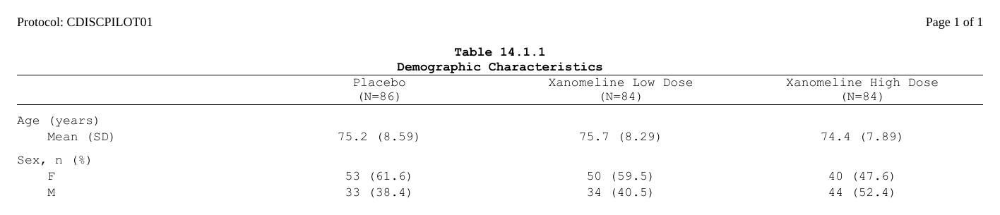
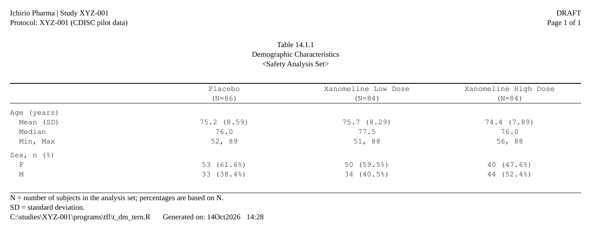

<!-- README.md is generated by hand; keep it short and link to the pkgdown site. -->

# rtfreporter 

<!-- badges: start -->
[](https://github.com/ichirio/rtfreporter/actions/workflows/R-CMD-check.yaml)
[](https://github.com/ichirio/rtfreporter/actions/workflows/test-coverage.yaml)
[](https://app.codecov.io/gh/ichirio/rtfreporter)
[](https://github.com/ichirio/rtfreporter/actions/workflows/pkgdown.yaml)
[](https://lifecycle.r-lib.org/articles/stages.html#experimental)
[](https://www.apache.org/licenses/LICENSE-2.0)
<!-- badges: end -->

**rtfreporter turns the tables you already make in R -- an ARD from
cards / cardx, an rtables / tern or a gtsummary table -- into clinical RTF
files: running header and footer, page numbers, titles and footnotes
included.**

## Why rtfreporter?

- **Your packages' tables, straight to RTF**: cards / cardx ARDs, rtables /
  tern, rlistings, gtsummary, gt, tfrmt, flextable, huxtable, data frames.
- **ARD first**: an ARD becomes a table in a few lines, `(N=xx)` included.
- **Submission-ready pages**: running headers and footers, titles, footnotes,
  pagination, listings and figures.
- **One deliverable**: outputs assembled with a cover page, a clickable table
  of contents and PDF bookmarks
  ([how](https://ichirio.github.io/rtfreporter/articles/assembling.html)).
- **Small, on purpose**: one clinical layout, base R only.

## Installation

Not on CRAN yet; from GitHub:

``` r
remotes::install_github("ichirio/rtfreporter@v0.8.2")   # the latest release
remotes::install_github("ichirio/rtfreporter")          # the development version
```

## From an ARD to an RTF table in 30 seconds

The ARD is the input, made with
[cards](https://pharmaverse.github.io/cards/) /
[cardx](https://insightsengineering.github.io/cardx/) before rtfreporter.
From there it is three steps:

<!-- flow: the same in README.md, vignettes/rtfreporter.Rmd and vignettes/articles/tables-from-ard.Rmd (tests/testthat/test-docs-flow.R) -->
<div class="rtf-flow">
<table>
<tr>
<td><strong>The ARD</strong><br>made with cards / cardx</td>
<td><strong>1. The table</strong><br><code>ard |&gt;</code><br><code>normalize_ard() |&gt;</code><br><code>table_plan() |&gt;</code><br><code>plan_*()</code></td>
<td><strong>2. The report</strong><br><code>rtf_document() |&gt;</code><br><code>rtf_section() |&gt;</code><br><code>rtf_tables(plan)</code></td>
<td><strong>3. The RTF file</strong><br><code>generate_rtfreport()</code></td>
</tr>
</table>
</div>
<!-- /flow -->

The page they write:

<p align="center">
  
</p>

The code:

``` r
library(rtfreporter)
library(cards)

# (ARD): made with cards / cardx -- data preparation, outside rtfreporter
adsl <- ADSL
adsl$ARM <- factor(adsl$ARM, c("Placebo", "Xanomeline Low Dose", "Xanomeline High Dose"))
ard <- ard_stack(adsl, .by = ARM,
                 ard_summary(variables = AGE),
                 ard_tabulate(variables = SEX))

# 1. the table, straight from the ARD
plan <- ard |>
  normalize_ard() |>
  table_plan(cols = "ARM", rows = c(group = "variable")) |>
  plan_cells(continuous  = c("Mean (SD)" = "{mean:.1f} ({sd:.2f})",
                             "Median"    = "{median:.1f}",
                             "Min, Max"  = "{min:.0f}, {max:.0f}"),
             categorical = "{n:.0f} ({p:.1f%}%)", notes = FALSE) |>
  plan_labels(c(AGE = "Age (years)", SEX = "Sex, n (%)")) |>
  plan_stub() |>
  plan_col_header(values = list(n = TRUE), rtf_col_header(c("", "{col}\n(N={n})")))

# 2. the report: the document around the table
report <- rtf_document(
  program = "/studies/XYZ-001/programs/tfl/t_dm.R",
  tokens  = list(STUDY = "XYZ-001")) |>
  rtf_section(
    header = rtf_header(list(
      c(l = "Ichirio Pharma | Study {STUDY}",      r = "DRAFT"),
      c(l = "Protocol: {STUDY} (CDISC pilot data)", r = "Page {PAGE} of {TOTAL_PAGES}"),
      c(c = ""),
      c(c = "Table 14.1.1"),
      c(c = "Demographic Characteristics"),
      c(c = "<Safety Analysis Set>"))),
    footer = rtf_footer(list(
      c(l = "N = number of subjects in the analysis set; percentages are based on N."),
      c(l = "SD = standard deviation."),
      c(l = "{PROGRAM_FULL}    Generated on: {DATETIME}")))) |>
  rtf_tables(plan)

# 3. the RTF file
generate_rtfreport(report, "t_dm.rtf")
```


The arms' `(N=xx)` come from the ARD: `ard_stack(.by = )` counts them.  The
same code pages a long table, sorts an adverse-events table by frequency,
and can be saved and reused:
[Get started](https://ichirio.github.io/rtfreporter/articles/rtfreporter.html),
[Tables from an ARD](https://ichirio.github.io/rtfreporter/articles/tables-from-ard.html),
and more tables, listings and figures in the
[Gallery](https://ichirio.github.io/rtfreporter/articles/gallery.html).

## An rtables / tern table

``` r
library(tern)

adsl$SEX <- factor(adsl$SEX)
lyt <- basic_table(show_colcounts = TRUE) |>
  split_cols_by("ARM") |>
  analyze_vars(c("AGE", "SEX"), var_labels = c(AGE = "Age (years)", SEX = "Sex, n (%)"),
               .stats   = c("mean_sd", "median", "range", "count_fraction"),
               .labels  = c(mean_sd = "Mean (SD)", median = "Median", range = "Min, Max"),
               .formats = c(mean_sd = "xx.x (xx.xx)", median = "xx.x", range = "xx, xx",
                            count_fraction = "xx (xx.x%)"))

rtf_document(
  program = "/studies/XYZ-001/programs/tfl/t_dm_tern.R",
  tokens  = list(STUDY = "XYZ-001")) |>
  rtf_section(
    header = rtf_header(list(
      c(l = "Ichirio Pharma | Study {STUDY}",      r = "DRAFT"),
      c(l = "Protocol: {STUDY} (CDISC pilot data)", r = "Page {PAGE} of {TOTAL_PAGES}"),
      c(c = ""),
      c(c = "Table 14.1.1"),
      c(c = "Demographic Characteristics"),
      c(c = "<Safety Analysis Set>"))),
    footer = rtf_footer(list(
      c(l = "N = number of subjects in the analysis set; percentages are based on N."),
      c(l = "SD = standard deviation."),
      c(l = "{PROGRAM_FULL}    Generated on: {DATETIME}")))) |>
  rtf_tables(as_rtftables(build_table(lyt, df = adsl))) |>
  generate_rtfreport("t_dm_tern.rtf")
```

<p align="center">
  
</p>

## A gtsummary table

``` r
library(gtsummary)

tbl <- tbl_summary(adsl, by = ARM, include = c(AGE, SEX),
                   type      = AGE ~ "continuous2",
                   statistic = list(AGE ~ c("{mean} ({sd})", "{median}", "{min}, {max}"),
                                    SEX ~ "{n} ({p}%)"),
                   digits    = list(AGE ~ c(1, 2, 1, 0, 0), SEX ~ c(0, 1)),
                   label     = list(AGE ~ "Age (years)", SEX ~ "Sex")) |>
  add_stat_label(label = list(AGE ~ c("Mean (SD)", "Median", "Min, Max"), SEX ~ "n (%)")) |>
  modify_header(label ~ "", all_stat_cols() ~ "{level}\n(N={n})") |>
  remove_footnote_header(columns = all_stat_cols())

rtf_document(
  program = "/studies/XYZ-001/programs/tfl/t_dm_gtsummary.R",
  tokens  = list(STUDY = "XYZ-001")) |>
  rtf_section(
    header = rtf_header(list(
      c(l = "Ichirio Pharma | Study {STUDY}",      r = "DRAFT"),
      c(l = "Protocol: {STUDY} (CDISC pilot data)", r = "Page {PAGE} of {TOTAL_PAGES}"),
      c(c = ""),
      c(c = "Table 14.1.1"),
      c(c = "Demographic Characteristics"),
      c(c = "<Safety Analysis Set>"))),
    footer = rtf_footer(list(
      c(l = "N = number of subjects in the analysis set; percentages are based on N."),
      c(l = "SD = standard deviation."),
      c(l = "{PROGRAM_FULL}    Generated on: {DATETIME}")))) |>
  rtf_tables(as_rtftables(tbl)) |>
  generate_rtfreport("t_dm_gtsummary.rtf")
```

The same table again, its labels and headers set in gtsummary
([the page it writes](man/figures/readme-gtsummary-example.png)).  gt,
tfrmt, flextable and huxtable tables, rlistings listings and plain data
frames go in the same way: see
[Importing tables](https://ichirio.github.io/rtfreporter/articles/importing-tables.html)
and the *same report, every framework* articles for
[Demographics](https://ichirio.github.io/rtfreporter/articles/showcase-dm.html)
and [Adverse events](https://ichirio.github.io/rtfreporter/articles/showcase-ae.html).

## Writing rtfreporter code with an AI assistant

rtfreporter is too new to be in any chat model's training data: asked for
rtfreporter code it reaches for `r2rtf`'s verbs or invents arguments, and
flags neither as a guess.  Give it the facts first.

The manuals **ship with the package**, so the one you attach describes the
version you actually have:

``` r
rtfreporter_ai_manual()                     # path to the user manual
rtfreporter_ai_manual("ai-kit", ard = ard)  # a folder to attach: the request, the manual,
                                            # three example programs, your ARD and its shape
```

Or download it -- **[AI user manual (v0.8.2)](https://ichirio.github.io/rtfreporter/ai/rtfreporter-ai-user-manual-0.8.2.md)** -- one self-contained file sized for a single chat session.  Attach it at the **start** of the session and say *"use this manual"*.  [`ai/rtfreporter-ai-user-manual.md`](https://ichirio.github.io/rtfreporter/ai/rtfreporter-ai-user-manual.md) always resolves to the newest release, so it is safe to bookmark; the development copy is published beside it under its own version.

Every example in it is run by CI and its function list is checked against
`NAMESPACE`, so a manual that drifts from the API fails the build.

Working *on* rtfreporter rather than with it?  See [Developing with an AI assistant](https://ichirio.github.io/rtfreporter/articles/ai-development.html), which covers the companion **developer** manual (`rtfreporter_ai_manual(which = "dev")`).

## A focused tool, on purpose

rtfreporter is a focused tool for the one clinical TFL layout, not a
general-purpose RTF library.  What that buys you:

- **One output style, opinionated defaults.**  No theme zoo, no
  "render anything" pipeline.  The defaults match the conventional
  clinical TFL look out of the box; you do not have to assemble it.
- **Only the features TFL → RTF needs.**  Multi-section headers /
  footers, spanning column headers, automatic page-number fields
  (`{PAGE}` / `{TOTAL_PAGES}`), embedded figures, and
  per-document concatenation via `assemble_rtf()`.  If a feature
  would not appear on a real clinical TFL, we resist adding it.
- **Maintainability over breadth.**  Saying *no* to scope creep is
  what keeps the package small, the tests fast, and the API stable.
- **Composable pipe API.**  `rtf_document() |> rtf_section() |>
  rtf_tables() |> generate_rtfreport()` — the same vocabulary every
  time, so building a 50-TFL deliverable is a loop.

If your deliverables need a substantially different layout, another tool
may serve you better — and that trade-off is intentional.  We would
rather do one well-defined style really well than do everything passably.
You are warmly welcome to use rtfreporter for the styles it supports.

## Why RTF?

RTF is an old format, and we are perfectly aware of that.  Producing
`.docx` directly, or rendering straight to PDF, is entirely possible and
in some respects more modern.  We chose RTF on purpose, for the most
old-fashioned of reasons: **it is the simplest thing that fully meets the
need.**

For clinical deliverables the workflow we care about is
**RTF → (optional post-processing) → PDF**, and that route is still
genuinely useful today:

- **Simple grammar.**  RTF is plain text with a small, well-understood
  command vocabulary.  That keeps the renderer small and auditable —
  which matters in a regulated setting.
- **Easy to patch when you must.**  Because the output is just text, a
  last-minute correction can be made by hand or by a small script,
  without round-tripping through a binary editor.
- **Universally openable.**  Every word processor opens RTF and exports
  it to PDF, so the final step fits whatever your organisation already
  uses.

A PDF-first or DOCX-first toolkit could do the same job, perhaps more
elegantly or with more features.  But for *our* needs — which are modest,
specific, and well-defined — RTF remains the easiest path that is
**necessary and sufficient**.  Simplicity, here, is the feature.

## Documentation

The full pkgdown site is at <https://ichirio.github.io/rtfreporter/>:

- **Gallery** — [tables, a listing and figures from the CDISC pilot data](https://ichirio.github.io/rtfreporter/articles/gallery.html),
  each with the code that wrote it
- **Get started** — [from an ARD to the RTF file](https://ichirio.github.io/rtfreporter/articles/rtfreporter.html)
  (`vignette("rtfreporter")`)
- **Tables from an ARD** (recommended) — [cards / cardx to RTF, step by step](https://ichirio.github.io/rtfreporter/articles/tables-from-ard.html),
  [the plan verbs](https://ichirio.github.io/rtfreporter/articles/plan-verbs.html) and
  [from `as_rtftables()` to a plan](https://ichirio.github.io/rtfreporter/articles/plan-and-as-rtftables.html)
- **Bring your own table** — gt / gtsummary / rtables / tfrmt / flextable /
  huxtable objects and data frames through
  [`as_rtftables()`](https://ichirio.github.io/rtfreporter/articles/importing-tables.html),
  [pagination](https://ichirio.github.io/rtfreporter/articles/pagination.html), and the
  *same report, every framework* articles ([Demographics](https://ichirio.github.io/rtfreporter/articles/showcase-dm.html),
  [Adverse events](https://ichirio.github.io/rtfreporter/articles/showcase-ae.html))
- **Listings** — [from the records](https://ichirio.github.io/rtfreporter/articles/plan-listings.html)
  or [from source data](https://ichirio.github.io/rtfreporter/articles/listings.html),
  including the column-width estimator and the wrapping rule
- **Figures** — [a plot object to a page](https://ichirio.github.io/rtfreporter/articles/figures.html)
- **Assembling a deliverable** — [headers, footers and tokens](https://ichirio.github.io/rtfreporter/articles/headers-footers.html),
  [borders and rules](https://ichirio.github.io/rtfreporter/articles/borders.html), and
  [joining files with a table of contents](https://ichirio.github.io/rtfreporter/articles/output.html)
- **Architecture & internals** — [the object model, the public classes and the rendering pipeline](https://ichirio.github.io/rtfreporter/articles/architecture.html)

## Status

Pre-1.0 (`lifecycle: experimental`): the latest release is `v0.8.2`, and
development continues on `main` -- see [`NEWS.md`](NEWS.md); the roadmap is in
the site's sidebar.

## Citation

If rtfreporter helps your work, please cite it:

```r
citation("rtfreporter")
```

If the numbers in your tables come from a [cards](https://pharmaverse.github.io/cards/) /
[cardx](https://insightsengineering.github.io/cardx/) ARD, please cite those
packages too (`citation("cards")`, `citation("cardx")`): they compute the
statistics; rtfreporter only lays them out.

## Acknowledgements

rtfreporter stands on the work of many others, and we are grateful to their
authors.

- **[cards](https://pharmaverse.github.io/cards/) and
  [cardx](https://insightsengineering.github.io/cardx/)** — the analysis
  results data (ARD) that `normalize_ard()` and the `plan_*()` verbs read are
  their design, an outcome of the [pharmaverse](https://pharmaverse.org/)
  community's work on analysis results data.
- **The table builders `as_rtftables()` reads** —
  [gt](https://gt.rstudio.com), [gtsummary](https://www.danieldsjoberg.com/gtsummary/),
  [tfrmt](https://gsk-biostatistics.github.io/tfrmt/),
  [rtables](https://CRAN.R-project.org/package=rtables) /
  [rlistings](https://CRAN.R-project.org/package=rlistings) /
  [tern](https://CRAN.R-project.org/package=tern),
  [flextable](https://davidgohel.github.io/flextable/) and
  [huxtable](https://hughjonesd.github.io/huxtable/).  rtfreporter reads the
  objects they build; the tables themselves are their work.
- **[pharmaverseadam](https://pharmaverse.github.io/pharmaverseadam/)** and the
  [pharmaverse examples](https://pharmaverse.github.io/examples/) — the ADaM
  data (from the CDISC pilot study) and the example tables behind many of our
  examples and articles.

rtfreporter is an independent project and is not affiliated with, or endorsed
by, the authors of these packages.

## Contributing & bug reports

Issues and pull requests are very welcome at
<https://github.com/ichirio/rtfreporter>. Please read
[`CONTRIBUTING.md`](CONTRIBUTING.md) and the
[code of conduct](CODE_OF_CONDUCT.md) first.

## License

Apache License 2.0 © 2026 Yoichi Masui. See [`LICENSE.md`](LICENSE.md).
