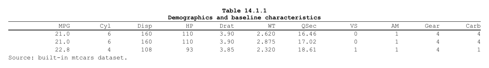
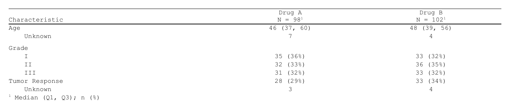
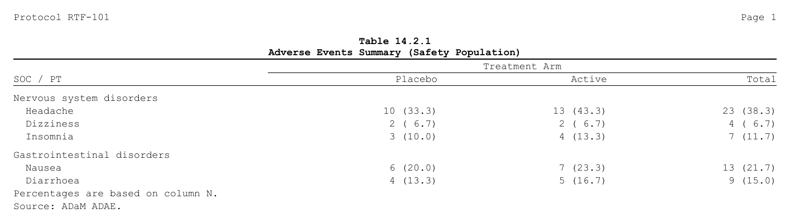

# From gt and gtsummary

``` r

library(rtfreporter)
```

> **The second path.** This article is about bringing a table you
> already have. When the statistics are in a cards / cardx ARD, the
> recommended route is a table plan – see [Get
> started](https://ichirio.github.io/rtfreporter/articles/rtfreporter.md)
> and [Tables from an
> ARD](https://ichirio.github.io/rtfreporter/articles/tables-from-ard.html).

The [gt](https://gt.rstudio.com) package by Posit gives users a friendly
grammar for *display tables* –
[`cols_label()`](https://gt.rstudio.com/reference/cols_label.html),
[`tab_header()`](https://gt.rstudio.com/reference/tab_header.html),
[`tab_spanner()`](https://gt.rstudio.com/reference/tab_spanner.html),
[`cols_align()`](https://gt.rstudio.com/reference/cols_align.html),
[`tab_source_note()`](https://gt.rstudio.com/reference/tab_source_note.html),
[`tab_footnote()`](https://gt.rstudio.com/reference/tab_footnote.html),
… Clinical summary tables are very often produced by
[gtsummary](https://www.danieldsjoberg.com/gtsummary/)
([`tbl_summary()`](https://www.danieldsjoberg.com/gtsummary/reference/tbl_summary.html),
[`tbl_regression()`](https://www.danieldsjoberg.com/gtsummary/reference/tbl_regression.html),
…) or [tfrmt](https://gsk-biostatistics.github.io/tfrmt/), both of which
ultimately render to a `gt_tbl`. When you move from the HTML world to
the clinical TFL world, you want that same metadata to flow into the RTF
document – not be re-stated in a different vocabulary.

## The recommended workflow: `as_rtftables()`

[`as_rtftables()`](https://ichirio.github.io/rtfreporter/reference/as_rtftables.md)
is the single entry point. It takes a table object (`gt_tbl`, a
**gtsummary** table, a `data.frame`/tibble, or a list of these), reads
all of the table’s metadata, paginates the body, and returns a list of
ready-to-render
[`rtftable()`](https://ichirio.github.io/rtfreporter/reference/rtftable.md)
objects – one per page:

      gt / gtsummary / tfrmt          as_rtftables()             rtf_tables()
      ------------------------  ->  read metadata + paginate  ->  add to doc  ->  generate_rtfreport()
            (a gt_tbl)               (list of rtftable pages)      (titles /
                                                                    footnotes
                                                                    flow through)

Show code

``` r

library(gt)

g <- gt(head(mtcars, 3)) |>
  cols_label(mpg = "MPG", cyl = "Cyl", disp = "Disp", hp = "HP",
             drat = "Drat", wt = "WT", qsec = "QSec",
             vs = "VS", am = "AM", gear = "Gear", carb = "Carb") |>
  tab_header(
    title    = "Table 14.1.1",
    subtitle = "Demographics and baseline characteristics"
  ) |>
  tab_source_note("Source: built-in mtcars dataset.")

pages <- as_rtftables(g)          # read_meta = TRUE by default
length(pages)                      # one page here
```

    #> [1] 1
    class(pages[[1]])
    #> [1] "rtftable"



Hand the pages straight to
[`rtf_tables()`](https://ichirio.github.io/rtfreporter/reference/rtf_tables.md).
The page-level title and source notes travel with each page (as
`rtf_titles` / `rtf_footnotes` attributes) and are picked up
automatically:

Show code

``` r

doc <- rtf_document() |>
  rtf_section(page = 1, header = NULL, footer = NULL) |>
  rtf_tables(pages)

doc$contents[[1]]$title       # title + subtitle, read from the gt object
```

    #> [1] "Table 14.1.1"                             
    #> [2] "Demographics and baseline characteristics"
    doc$contents[[1]]$footnote    # source note
    #> [1] "Source: built-in mtcars dataset."

For a single page you can use the convenience wrapper
[`as_rtftable()`](https://ichirio.github.io/rtfreporter/reference/as_rtftable.md),
which returns one `rtftable` instead of a list:

``` r

tbl <- as_rtftable(g)   # == as_rtftables(g, split = "none")[[1]]
class(tbl)
#> [1] "rtftable"
```

## gtsummary in one line

A gtsummary table is converted to a `gt_tbl` automatically (via
[`gtsummary::as_gt()`](https://www.danieldsjoberg.com/gtsummary/reference/as_gt.html)),
so the workflow is identical:

Show code

``` r

library(gtsummary)

s <- tbl_summary(
  trial[c("age", "grade", "response", "trt")],
  by = trt
)

pages <- as_rtftables(s)

doc <- rtf_document() |>
  rtf_section(page = 1, header = NULL, footer = NULL) |>
  rtf_tables(pages)

out <- tempfile(fileext = ".rtf")
generate_rtfreport(doc, out, overwrite = TRUE)
file.exists(out)
```

    #> [1] TRUE



Everything structural – column labels, spanning headers, the stub /
group rows with their indentation, footnote texts and marks – comes
through. Visual details such as bold group-header rows are dropped (see
*Limitations* below).

## Splitting a long table across pages

[`as_rtftables()`](https://ichirio.github.io/rtfreporter/reference/as_rtftables.md)
splits a table that is too tall for one page; pass `split` and
`max_rows`:

Show code

``` r

long <- data.frame(
  Parameter = sprintf("Row %02d", 1:8),
  Value     = round(rnorm(8), 2),
  stringsAsFactors = FALSE
)
pages <- as_rtftables(long, split = "group_force", max_rows = 4,
                      group_col = "Parameter")
length(pages)                       # 2 pages
```

    #> [1] 2
    vapply(pages, function(p) nrow(p$data), integer(1))
    #> [1] 4 4

Per-cell styles read from a gt object are sliced to match each page
automatically.

## What gets read

`read_meta = TRUE` (the default) reads every token below. Pass
`read_meta = c("col_header", "titles")` to read only some of them, or
`read_meta = FALSE` to read none.

- `"col_header"` –
  [`cols_label()`](https://gt.rstudio.com/reference/cols_label.html) -\>
  the column header
- `"alignment"` –
  [`cols_align()`](https://gt.rstudio.com/reference/cols_align.html) -\>
  each column’s alignment
- `"spanning"` –
  [`tab_spanner()`](https://gt.rstudio.com/reference/tab_spanner.html)
  -\> spanning header rows
- `"widths"` –
  [`cols_width()`](https://gt.rstudio.com/reference/cols_width.html) -\>
  column widths (`"NNpx"` or `"NN%"`)
- `"titles"` –
  [`tab_caption()`](https://gt.rstudio.com/reference/tab_caption.html)
  and `tab_header(title, subtitle)` -\> the page titles
- `"footnotes"` –
  [`tab_footnote()`](https://gt.rstudio.com/reference/tab_footnote.html)
  texts, then
  [`tab_source_note()`](https://gt.rstudio.com/reference/tab_source_note.html)
  -\> the page footnotes
- `"footnote_marks"` – the footnote marks gt prints on column labels,
  spanning headers, the title and row-group labels -\> `^{N}`
  superscripts, in gt’s order, so the marks match the notes (in-cell
  marks are always written as `^{N}`)
- `"styles"` – explicit
  [`tab_style()`](https://gt.rstudio.com/reference/tab_style.html)
  declarations -\> bold, italic, underline, alignment and borders, plus
  body text colour

Some things are always done, with no token: hidden columns are dropped,
the stub and row-group rows are placed in the body (group rows indented
under their heading), and stray HTML in cells is removed (`<br>` becomes
a line break).

A token you leave out falls back to the rtfreporter default (e.g. column
names from `names(data)`). A token that no table source knows is an
error.

## End-to-end example: a TFL-style adverse-events table

This is the kind of table you would normally build by hand:

Show code

``` r

ae <- data.frame(
  SOC = c("Nervous system disorders",
          "Nervous system disorders",
          "Nervous system disorders",
          "Gastrointestinal disorders",
          "Gastrointestinal disorders"),
  PT  = c("Headache", "Dizziness", "Insomnia",
          "Nausea",   "Diarrhoea"),
  Placebo_n = c("10 (33.3)", "2 ( 6.7)", "3 (10.0)",
                "6 (20.0)",  "4 (13.3)"),
  Active_n  = c("13 (43.3)", "2 ( 6.7)", "4 (13.3)",
                "7 (23.3)",  "5 (16.7)"),
  Total_n   = c("23 (38.3)", "4 ( 6.7)", "7 (11.7)",
                "13 (21.7)", "9 (15.0)"),
  stringsAsFactors = FALSE
)

ae_gt <-
  gt(ae, groupname_col = "SOC", rowname_col = "PT") |>
  cols_label(PT = "Preferred Term",
             Placebo_n = "Placebo",
             Active_n  = "Active",
             Total_n   = "Total") |>
  tab_stubhead(label = "SOC / PT") |>
  cols_align("right", columns = c(Placebo_n, Active_n, Total_n)) |>
  tab_spanner(label = "Treatment Arm",
              columns = c(Placebo_n, Active_n, Total_n)) |>
  tab_header(title    = "Table 14.2.1",
             subtitle = "Adverse Events Summary (Safety Population)") |>
  tab_source_note("Source: ADaM ADAE.") |>
  tab_footnote("Percentages are based on column N.")
```

Convert it with
[`as_rtftables()`](https://ichirio.github.io/rtfreporter/reference/as_rtftables.md)
and add the pages to a document:

Show code

``` r

doc <- rtf_document() |>
  rtf_section(
    page   = 1,
    header = rtf_header(rows = list(c(l = "Protocol RTF-101",
                                       r = "Page {AUTO_PAGE}"))),
    footer = NULL
  ) |>
  rtf_tables(as_rtftables(ae_gt))
```



`doc$contents[[1L]]$content` now has:

``` r

tbl <- doc$contents[[1L]]$content
nrow(tbl$data)          # 5 PT rows + 2 SOC group rows
#> [1] 7
tbl$data$rowname[1:3]   # the SOC's heading row, then its first two PTs, indented
#> [1] "Nervous system disorders" "  Headache"              
#> [3] "  Dizziness"
tbl$col_header          # spanner row + stubhead-labelled bottom row
#> [[1]]
#> [[1]][[1]]
#> [[1]][[1]]$from
#> [1] 1
#> 
#> [[1]][[1]]$to
#> [1] 1
#> 
#> [[1]][[1]]$label
#> [1] ""
#> 
#> 
#> [[1]][[2]]
#> [[1]][[2]]$from
#> [1] 2
#> 
#> [[1]][[2]]$to
#> [1] 4
#> 
#> [[1]][[2]]$label
#> [1] "Treatment Arm"
#> 
#> [[1]][[2]]$align
#> [1] "center"
#> 
#> 
#> 
#> [[2]]
#> [1] "SOC / PT" "Placebo"  "Active"   "Total"
```

Page-level blocks:

``` r

doc$contents[[1L]]$title      # title + subtitle
#> [1] "Table 14.2.1"                              
#> [2] "Adverse Events Summary (Safety Population)"
doc$contents[[1L]]$footnote   # footnote text + source note (in that order)
#> [1] "Percentages are based on column N." "Source: ADaM ADAE."
```

Render to RTF:

``` r

out <- tempfile(fileext = ".rtf")
generate_rtfreport(doc, out, overwrite = TRUE)
file.exists(out)
#> [1] TRUE
```

## Precedence: explicit arguments beat gt-extracted values

The translation honours the documented precedence chain. If you specify
`col_header = c("A", "B", ...)` explicitly, gt’s
[`cols_label()`](https://gt.rstudio.com/reference/cols_label.html) is
ignored for that table:

Show code

``` r

g <- gt(head(mtcars, 1)[, "mpg", drop = FALSE]) |>
  cols_label(mpg = "MPG")
tbl <- as_rtftable(g, read_meta = TRUE, col_header = "Override")
tbl$col_header[[1L]]
```

    #> [1] "Override"

The same applies to:

| Slot | Explicit arg |
|----|----|
| Column header | `col_header` |
| Per-column alignment | `col_spec[[j]]$align` |
| Spanner stack | (passed via `col_header`) |
| Absolute widths | `column_widths_twips` |
| Relative widths | `col_rel_width` |
| Page titles | [`rtf_titles()`](https://ichirio.github.io/rtfreporter/reference/rtf_titles.md) |
| Page footnotes | [`rtf_footnotes()`](https://ichirio.github.io/rtfreporter/reference/rtf_footnotes.md) |

Per-column `col_spec` entries are **deep-merged** – a user-supplied
`align = "left"` for column 1 only knocks out gt’s column-1 alignment,
the other columns keep gt’s values.

## Limitations

The following gt / gtsummary features depend on HTML/CSS rendering that
RTF cannot reproduce, so they are intentionally **not** carried through:

- **Bold group-header rows.** Applied by gtsummary through
  [`tab_style()`](https://gt.rstudio.com/reference/tab_style.html) in a
  way that the style reader does not currently map to a whole-row
  attribute. (Cell-level `tab_style(cell_text(...))` *is* read – see the
  `"styles"` token.)
- **Cell background colour / fill.** Not read.
- **Markdown inside titles / labels.** `md("**bold**")` is flattened to
  plain text: the `**` markers are removed.
- **`column_width` strings other than `"NNpx"` or `"NN%"`.** Mixed-unit
  widths bail out to `NULL` and the renderer falls back to its default
  proportional split.

## See also

- [`?as_rtftables`](https://ichirio.github.io/rtfreporter/reference/as_rtftables.md)
  and
  [`?as_rtftable`](https://ichirio.github.io/rtfreporter/reference/as_rtftable.md)
  for the per-argument docs.
- [`?rtf_tables`](https://ichirio.github.io/rtfreporter/reference/rtf_tables.md)
  for appending pages to a document.
- The `gt` package documentation: <https://gt.rstudio.com>.
- The `gtsummary` package: <https://www.danieldsjoberg.com/gtsummary/>.

## Where next

- [From rtables and
  tern](https://ichirio.github.io/rtfreporter/articles/from-rtables.md)
  — the same for an rtables or tern table
- [Importing
  tables](https://ichirio.github.io/rtfreporter/articles/importing-tables.html)
  — every source
  [`as_rtftables()`](https://ichirio.github.io/rtfreporter/reference/as_rtftables.md)
  reads, flextable and huxtable included
- [The pharmaverse
  catalog](https://ichirio.github.io/rtfreporter/articles/tlg-catalog.html)
  — the same tables built five different ways

The four recipes (`?rtfreporter-recipes`) are the same ground covered as
runnable help-page examples: demographics, adverse events, PK and
laboratory, each data-in to RTF-out.
