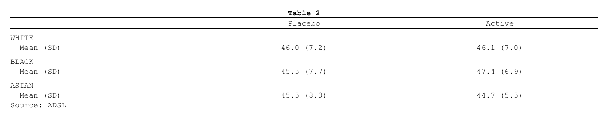

# From rtables and tern

``` r

library(rtfreporter)
```

> **The second path.** This article is about bringing a table you
> already have. When the statistics are in a cards / cardx ARD, the
> recommended route is a table plan – see [Get
> started](https://ichirio.github.io/rtfreporter/articles/rtfreporter.md)
> and [Tables from an
> ARD](https://ichirio.github.io/rtfreporter/articles/tables-from-ard.md).

An [rtables](https://CRAN.R-project.org/package=rtables) table –
including the tables [tern](https://CRAN.R-project.org/package=tern)’s
analysis functions build, which are rtables objects – goes to RTF
through
[`as_rtftables()`](https://ichirio.github.io/rtfreporter/reference/as_rtftables.md),
as it is.

## From an rtables table to RTF

[`as_rtftables()`](https://ichirio.github.io/rtfreporter/reference/as_rtftables.md)
also accepts any **rtables** `VTableTree` – including the tables
produced by **tern** analysis functions, which are rtables objects. They
are read through
[`formatters::matrix_form()`](https://pharmaverse.github.io/formatters/latest-tag/reference/matrix_form.html),
so nested column splits become spanning headers, the row-label stub
keeps its indentation, and the titles / footers / referential footnotes
flow through. In-cell footnote marks `{N}` are rewritten to `^{N}`.

``` r

library(rtables)
#> Loading required package: formatters
#> 
#> Attaching package: 'formatters'
#> The following object is masked from 'package:base':
#> 
#>     %||%
#> 
#> Attaching package: 'rtables'
#> The following object is masked from 'package:utils':
#> 
#>     str
```

Show code

``` r


lyt <- basic_table(title = "Table 2", main_footer = "Source: ADSL") |>
  split_cols_by("ARM") |>
  split_rows_by("RACE") |>
  analyze("AGE", afun = function(x) {
    in_rows("Mean (SD)" = rcell(c(mean(x), sd(x)), format = "xx.x (xx.x)"))
  })

set.seed(1)
adsl <- data.frame(
  ARM  = rep(c("Placebo", "Active"), each = 30),
  RACE = rep(c("WHITE", "BLACK", "ASIAN"), 20),
  AGE  = rnorm(60, 45, 8)
)
tern_like <- build_table(lyt, adsl)

doc <- rtf_document() |>
  rtf_section(page = 1, header = NULL, footer = NULL) |>
  rtf_tables(as_rtftables(tern_like))

out <- tempfile(fileext = ".rtf")
generate_rtfreport(doc, out, overwrite = TRUE)
file.exists(out)
```

    #> [1] TRUE



The rtables `read` tokens are `"col_header"`, `"alignment"`,
`"spanning"`, `"titles"`, `"footnotes"`, `"indent"`, `"footnote_marks"`;
`read = TRUE` (default) reads them all.

## Splitting a long table across pages

[`as_rtftables()`](https://ichirio.github.io/rtfreporter/reference/as_rtftables.md)
pages the table: `split` and `max_rows` say how, as for any source – see
[Paginating with
as_rtftables()](https://ichirio.github.io/rtfreporter/articles/pagination.md).

## Where next

- [From gt and
  gtsummary](https://ichirio.github.io/rtfreporter/articles/from-gt.md)
  — the same for a gt or gtsummary table
- [Importing
  tables](https://ichirio.github.io/rtfreporter/articles/importing-tables.md)
  — every source
  [`as_rtftables()`](https://ichirio.github.io/rtfreporter/reference/as_rtftables.md)
  reads
- [The pharmaverse
  catalog](https://ichirio.github.io/rtfreporter/articles/tlg-catalog.md)
  — tern tables and others, to RTF
