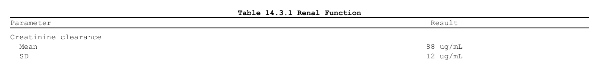

# Rendering and post-processing

``` r

library(rtfreporter)
```

Once a document is built, three steps turn it into a deliverable:
**render** it to an `.rtf`, optionally **post-process** the file, and –
for a multi-table package – **assemble** several RTFs into one with a
table of contents.

Show code

``` r

df <- data.frame(
  Parameter = c("Creatinine clearance", "  Mean", "  SD"),
  Result    = c("", "88 ug/mL", "12 ug/mL"),
  stringsAsFactors = FALSE
)
doc <- rtf_document() |>
  rtf_tables(as_rtftables(df), titles = list(c("Table 14.3.1 Renal Function")))
```



## Rendering – `generate_rtfreport()`

[`generate_rtfreport()`](https://ichirio.github.io/rtfreporter/reference/generate_rtfreport.md)
writes the document to a file you can open in Word or LibreOffice. Use
`overwrite = TRUE` to replace an existing file.

``` r

out <- tempfile(fileext = ".rtf")
generate_rtfreport(doc, out, overwrite = TRUE)
file.exists(out)
#> [1] TRUE
```

The file can also be said where the document is made, with the program:
`rtf_document(file = )` keeps it in the document, and
`generate_rtfreport(doc)` writes there. A `file_path` given to
[`generate_rtfreport()`](https://ichirio.github.io/rtfreporter/reference/generate_rtfreport.md)
wins, so the same document can still be written somewhere else for a
check.

Show code

``` r

out2 <- tempfile(fileext = ".rtf")
doc2 <- rtf_document(file = out2) |>
  rtf_tables(as_rtftables(df), titles = list(c("Table 14.3.1 Renal Function")))
generate_rtfreport(doc2)
file.exists(out2)
```

    #> [1] TRUE

## Post-processing – `rtf_replace_text()`

Sometimes the rendered file needs a small tweak that you do not want to
push back into the (validated) source data.
[`rtf_replace_text()`](https://ichirio.github.io/rtfreporter/reference/rtf_replace_text.md)
does a find/replace directly on the generated `.rtf`.

A typical case is **units**: the analysis dataset carries an ASCII-safe
token like `ug/mL`, but the report should display `µg/mL`. Rather than
putting a non-ASCII character in the data, render with the ASCII token
and swap it in the finished file. The replacement is the RTF unicode
escape for `µ` (U+00B5 = 181), i.e. `\u181?`:

Show code

``` r

final <- tempfile(fileext = ".rtf")
rtf_replace_text(out, "ug/mL", "\\u181?g/mL", output_file = final)

rtf <- paste(readLines(final, warn = FALSE), collapse = "\n")
grepl("\\u181?g/mL", rtf, fixed = TRUE)   # Word/LibreOffice show "µg/mL"
```

    #> [1] TRUE

The same approach swaps any ASCII placeholder for a symbol you cannot
(or prefer not to) carry in the source data.
[`rtf_replace_text()`](https://ichirio.github.io/rtfreporter/reference/rtf_replace_text.md)
also supports vectorised targets, fixed or regex matching
(`use_regex = TRUE`), case-insensitive matching, in-place editing (with
an automatic `.bak`) or writing to a separate `output_file`. See
[`?rtf_replace_text`](https://ichirio.github.io/rtfreporter/reference/rtf_replace_text.md).

> Note: rtfreporter already escapes non-ASCII characters you put in the
> data (so `"µg/mL"` in a cell renders correctly too). Post-processing
> is the tool for the “last mile” – when the source must stay ASCII, or
> for a one-off fix to a finished file.

## Assembling several RTFs – `assemble_rtf()`

Many outputs become one deliverable – a cover page, a table of contents
whose entries are links, and a bookmark per output – with
[`assemble_rtf()`](https://ichirio.github.io/rtfreporter/reference/assemble_rtf.md):
see [Assembling reports into one
document](https://ichirio.github.io/rtfreporter/articles/assembling.md).

That completes the workflow for one output: build a document, render it,
and post-process it if needed. See
[`?generate_rtfreport`](https://ichirio.github.io/rtfreporter/reference/generate_rtfreport.md),
[`?rtf_replace_text`](https://ichirio.github.io/rtfreporter/reference/rtf_replace_text.md),
and
[`?assemble_rtf`](https://ichirio.github.io/rtfreporter/reference/assemble_rtf.md)
for full references.

## Where next

- [Assembling reports into one
  document](https://ichirio.github.io/rtfreporter/articles/assembling.md)
  — many outputs, one deliverable
- [The pharmaverse
  catalog](https://ichirio.github.io/rtfreporter/articles/tlg-catalog.md)
  — complete worked deliverables

The four recipes (`?rtfreporter-recipes`) are the same ground covered as
runnable help-page examples: demographics, adverse events, PK and
laboratory, each data-in to RTF-out.
