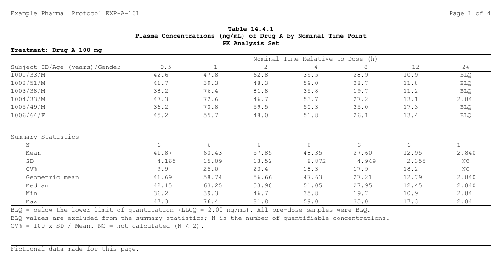
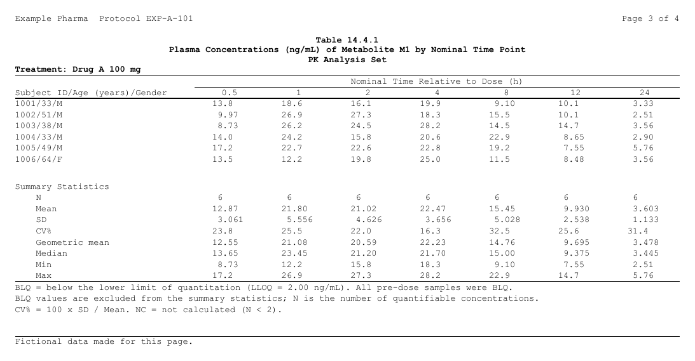

```{r, include = FALSE}
# A chunk's code sits under "Show code": open when it is what the page is
# about (`fold = "open"`), closed when it only supports it (`fold = "closed"`,
# the default unless the page sets another); `fold = FALSE` shows it plain,
# and so is code of three lines or fewer.
# Its results stay outside, always shown.
.fold_src <- knitr::knit_hooks$get("source")
knitr::knit_hooks$set(source = function(x, options) {
  f <- if (is.null(options$fold)) "closed" else options$fold
  if (isFALSE(f) || length(unlist(strsplit(x, "\n", fixed = TRUE))) <= 3L) {
    return(.fold_src(x, options))
  }
  paste0("\n\n<details", if (identical(f, "open")) " open", ">",
         "<summary>Show code</summary>\n\n",
         .fold_src(x, options), "\n\n</details>\n\n")
})
knitr::opts_chunk$set(fold = "open")   # this page: the code is the subject
knitr::opts_chunk$set(collapse = TRUE, comment = "#>",
                      message = FALSE, warning = FALSE)
options(width = 100)
# The files are written in a folder of their own: RTFREPORTER_ARTICLE_OUT
# when data-raw/gen_plan_append.R renders the page (it makes the pictures
# from them), a temporary one otherwise.  The pictures are committed in
# img/plan-append/ beside this page, so they show on GitHub too.
knitr::opts_knit$set(root.dir = Sys.getenv("RTFREPORTER_ARTICLE_OUT", tempdir()))
```

<p align="right">
  <a class="btn btn-outline-secondary btn-sm" href="plan-append-ja.html">In Japanese</a>
</p>

A PK concentration table often lists every subject's concentrations by time
point and, under them on the same columns, their summary statistics. The two
parts come from two sources -- the records and an ARD of their statistics --
but they are **one table**: one column header, one set of column widths, and
a page for each analyte and treatment that holds both parts of that group.

In rtfreporter each part is an ordinary [plan](plan-and-as-rtftables.html),
and `plan_append()` lays the rows of the second under the rows of the first.
This page builds such a table for a fictional study.

```{r setup, fold = FALSE}
library(rtfreporter)
```

## The data

A fictional study of Example Pharma: Drug A at 100 mg and 200 mg, six
subjects each, plasma concentrations of Drug A and its metabolite M1 at seven
nominal times after the dose. The lower limit of quantitation (LLOQ) is
2.00 ng/mL; a sample below it is BLQ (`AVAL` missing). Every pre-dose
sample is BLQ, so the table starts at 0.5 h.

```{r data, fold = "closed"}
set.seed(20261102)
subj <- data.frame(USUBJID = as.character(1001:1012),
                   ARM = rep(c("Drug A 100 mg", "Drug A 200 mg"), each = 6),
                   AGE = sample(28:64, 12, replace = TRUE),
                   SEX = sample(c("M", "F"), 12, replace = TRUE),
                   dose = rep(c(100, 200), each = 6))
tpt <- data.frame(ATPTN = c(0.5, 1, 2, 4, 8, 12, 24),
                  ATPT = c("0.5", "1", "2", "4", "8", "12", "24"))
analyte <- data.frame(ANALYTE = c("Drug A", "Metabolite M1"),
                      frac = c(1, 0.3), ke = c(0.17, 0.09))
adpc <- merge(merge(subj, tpt, by = NULL), analyte, by = NULL)
conc <- with(adpc, frac * dose * 0.9 * 1.4 / (1.4 - ke) *
                     (exp(-ke * ATPTN) - exp(-1.4 * ATPTN)))
conc <- conc * stats::rlnorm(nrow(adpc), 0, 0.25)
adpc$AVAL <- ifelse(conc < 2, NA_real_, signif(conc, 3))   # BLQ: missing
adpc <- adpc[order(adpc$ANALYTE, adpc$ARM, adpc$USUBJID, adpc$ATPTN),
             c("USUBJID", "ARM", "AGE", "SEX", "ANALYTE", "ATPT", "AVAL")]
head(adpc)
```

## The two parts

**The listing** is a plan on the records: a row a subject, a column a time
point, the concentration in each cell. The row label puts the subject's ID,
age and sex together (`1001/33/M`); a BLQ sample prints `BLQ`. The
concentrations print to three significant digits, as reported.

```{r listing}
listing <- adpc |>
  table_plan(cols = "ATPT", rows = c(subject = ~ "{USUBJID}/{AGE}/{SEX}"),
             value = "AVAL") |>
  plan_cells("{value:.3s}", na = "BLQ")
```

**The summary** is a plan on an ARD of the quantifiable concentrations, by
analyte, treatment and time point. Its constant row key (`block = ~ "Summary
Statistics"`) makes the heading row above its statistics. Mean, SD,
geometric mean and median take one significant digit more than the data,
minimum and maximum the data's, CV% one decimal:

```{r summary}
pk_stats <- ~ list(N = length, mean = mean, sd = stats::sd,
                   cv = function(x) 100 * stats::sd(x) / mean(x),
                   geo_mean = function(x) exp(mean(log(x))),
                   median = stats::median, min = min, max = max)
ard <- cards::ard_summary(adpc[!is.na(adpc$AVAL), ], by = c(ANALYTE, ARM, ATPT),
                          variables = AVAL, statistic = pk_stats)
summary <- normalize_ard(ard) |>
  table_plan(cols = "ATPT", rows = c(block = ~ "Summary Statistics")) |>
  plan_cells(continuous = cell_rows(
    N = "{N:.0f}", Mean = "{mean:.4s}",
    SD = c(is.na(sd) ~ "NC", "{sd:.4s}"),          # NC: not calculated (N < 2)
    "CV%" = c(is.na(cv) ~ "NC", "{cv:.1f}"),
    "Geometric mean" = "{geo_mean:.4s}", Median = "{median:.4s}",
    Min = "{min:.3s}", Max = "{max:.3s}"))
```

Each runs on its own, as any plan does: `plan_apply(summary, "table")` is
the summary of every group at once.

## One table

`listing` is the **parent**: the table has its column axis and header.
`plan_append(summary)` lays the summary's rows under the listing's. The
whole table's settings follow -- the column order, a blank row between the
parts, the header over both, the widths and the decimal alignment, a page
for each analyte and treatment, the style:

```{r table}
pk <- listing |>
  plan_append(summary, name = "summary") |>
  plan_levels(ATPT = tpt$ATPT, ANALYTE = analyte$ANALYTE) |>
  plan_blanks(where = "between_parts") |>
  plan_col_header(rtf_col_header(
    list(col_cell(1, ""), col_cell(c(2, nrow(tpt) + 1L), "Nominal Time Relative to Dose (h)")),
    c("Subject ID/Age (years)/Gender", "{col}"))) |>
  plan_columns(widths = c(label = 2.6, .values = 1), decimal = ".values") |>
  plan_paginate_rows(page_by = c("ANALYTE", "ARM")) |>
  plan_style(border = "tfl") |>
  plan_after(function(x) lapply(x, style_zone, last_row = rtf_border(bottom = TRUE)))
```

The parts are stacked **before** the pages are cut, so the page of
`Drug A` / `Drug A 100 mg` holds that group's listing rows and then that
group's summary rows, matched by value. `{ANALYTE}` and `{ARM}` in the
titles take each page's values:

```{r doc}
doc <- rtf_document(tokens = list(STUDY = "EXP-A-101")) |>
  rtf_section(header = rtf_header(list(c(l = "Example Pharma  Protocol {STUDY}",
                                         r = "Page {PAGE} of {TOTAL_PAGES}"))),
              footer = rtf_footer(list(c(l = "Fictional data made for this page.")))) |>
  rtf_tables(pk,
             titles = list(list("Table 14.4.1",
                                "Plasma Concentrations (ng/mL) of {ANALYTE} by Nominal Time Point",
                                "PK Analysis Set",
                                list(text = "Treatment: {ARM}", align = "left"))),
             footnotes = list(c(
               "BLQ = below the lower limit of quantitation (LLOQ = 2.00 ng/mL). All pre-dose samples were BLQ.",
               "BLQ values are excluded from the summary statistics; N is the number of quantifiable concentrations.",
               "CV% = 100 x SD / Mean. NC = not calculated (N < 2).")))
rtf_layout(doc)
generate_rtfreport(doc, "pk_conc.rtf", overwrite = TRUE)
```

Page 1, Drug A at 100 mg:



Page 3, the metabolite at 100 mg -- the same columns, its own rows:



## The rules

**The whole table's settings are the parent's, written anywhere in it.** The
column order, the header, the widths and decimal split, the pages, the
blank rows between the parts, the style, titles, footnotes and the steps
after belong to the table, not to a part. They may come before or after
`plan_append()`; the later of two wins, as always:

```{r rules-order}
pk_before <- listing |>
  plan_levels(ATPT = tpt$ATPT, ANALYTE = analyte$ANALYTE) |>
  plan_paginate_rows(page_by = c("ANALYTE", "ARM")) |>
  plan_append(summary, name = "summary")
pk_after <- listing |>
  plan_append(summary, name = "summary") |>
  plan_paginate_rows(page_by = "ANALYTE") |>               # replaced below
  plan_levels(ATPT = tpt$ATPT, ANALYTE = analyte$ANALYTE) |>
  plan_paginate_rows(page_by = c("ANALYTE", "ARM"))
identical(plan_apply(pk_before), plan_apply(pk_after))
```

**A part says how its own rows are made, and nothing about the whole
table.** Its cells, digits, labels, empty-cell text and the levels of its
row keys are its own; what it does not say it takes from the parent. A
whole-table setting in a part stops, naming where it goes:

```{r rules-part, error = TRUE}
listing |>
  plan_append(summary |> plan_col_header(rtf_col_header(c("", "{col}"))))
```

**Every group of the pages must be in every part.** A page holds the
parent's rows of its group and each part's rows of the same group. A group
the parent has and a part has not stops, since a report is not defined by a
group that is missing; `absent = "skip"` says that page has no rows of that
part:

```{r rules-absent, error = TRUE}
# a summary with no metabolite at 200 mg
ard_part <- ard[!(ard$group1_level %in% list("Metabolite M1") &
                  ard$group2_level %in% list("Drug A 200 mg")), ]
summary_part <- normalize_ard(ard_part) |>
  table_plan(cols = "ATPT", rows = c(block = ~ "Summary Statistics")) |>
  plan_cells(continuous = c(N = "{N:.0f}", Mean = "{mean:.4s}"))
pk_missing <- listing |>
  plan_append(summary_part) |>
  plan_paginate_rows(page_by = c("ANALYTE", "ARM"))
invisible(plan_apply(pk_missing))
pk_skip <- listing |>
  plan_append(summary_part, absent = "skip") |>
  plan_paginate_rows(page_by = c("ANALYTE", "ARM"))
length(plan_apply(pk_skip))       # four pages; the last has the listing only
```

## Where next

- [`plan_append()`](../reference/plan_append.html) --- the reference, with
  every verb a part may carry
- [Plans and as_rtftables()](plan-and-as-rtftables.html) --- what a plan is
- [Pagination](pagination.html) --- `page_by`, and cutting the columns
- [Several contents on one page](several-contents.html) --- two separate
  tables, or a table and a figure, on one page
