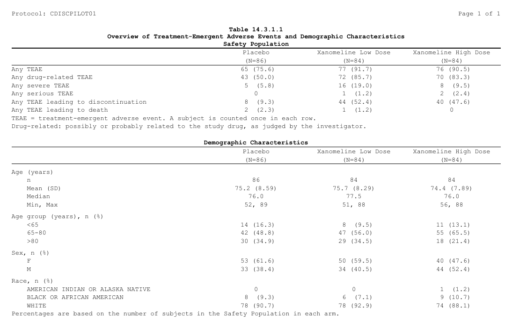
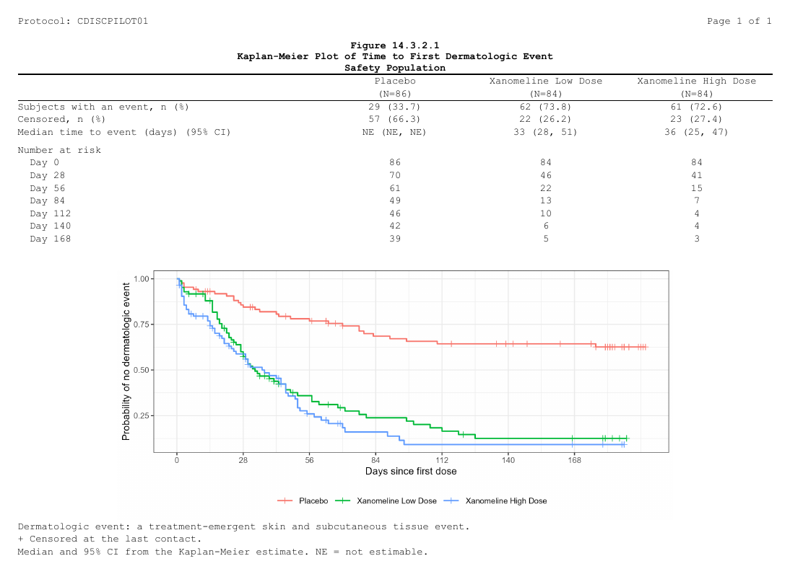
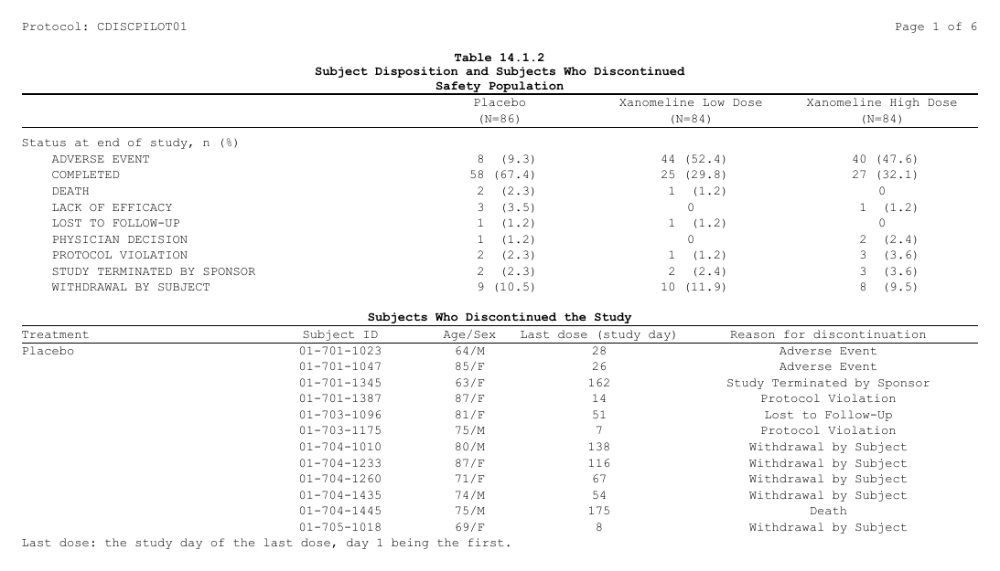
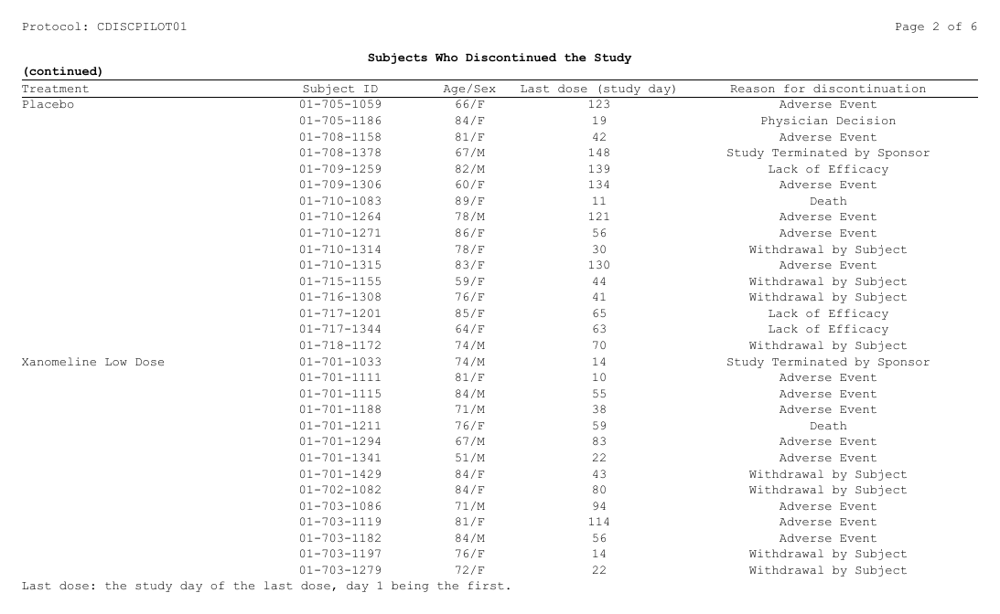
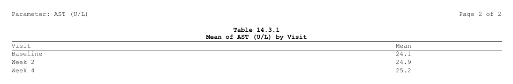

```{r, include = FALSE}
# A chunk's code sits under "Show code": open when it is what the page is
# about (`fold = "open"`), closed when it only supports it (`fold = "closed"`,
# the default unless the page sets another); `fold = FALSE` shows it plain,
# and so is code of three lines or fewer.
# Its results stay outside, always shown.
.fold_src <- knitr::knit_hooks$get("source")
knitr::knit_hooks$set(source = function(x, options) {
  f <- if (is.null(options$fold)) "closed" else options$fold
  if (isFALSE(f) || length(unlist(strsplit(x, "\n", fixed = TRUE))) <= 3L) {
    return(.fold_src(x, options))
  }
  paste0("\n\n<details", if (identical(f, "open")) " open", ">",
         "<summary>Show code</summary>\n\n",
         .fold_src(x, options), "\n\n</details>\n\n")
})
knitr::opts_chunk$set(fold = "open")   # this page: the code is the subject
knitr::opts_chunk$set(collapse = TRUE, comment = "#>",
                      message = FALSE, warning = FALSE)
options(width = 100)
# The files are written in a folder of their own: RTFREPORTER_ARTICLE_OUT
# when data-raw/gen_several_contents.R renders the page (it makes the
# pictures from them), a temporary one otherwise.  The pictures are
# committed in img/several-contents/ beside this page, so they show on
# GitHub too.
knitr::opts_knit$set(root.dir = Sys.getenv("RTFREPORTER_ARTICLE_OUT", tempdir()))
```

<p align="right">
  <a class="btn btn-outline-secondary btn-sm" href="several-contents.html">In English</a>
</p>

帳票では、1 ページに 2 つのコンテンツを置くことがよくあります。集計表とその元のリスティング、
表とその図、短い表 2 つなどです。rtfreporter では `rtf_tables()` や `rtf_figures()` を
1 回呼ぶごとにコンテンツが 1 つ足され、`page_break = FALSE` を付けると、新しいページではなく
前のコンテンツの下に続きます。この記事では、そうした帳票を 3 つ作り、その決まりを説明します。

```{r setup, fold = FALSE}
library(rtfreporter)
```

## 引数

| 引数 | 関数 | 働き |
|---|---|---|
| `page_break` | `rtf_tables()`, `rtf_figures()` | `TRUE`（既定）: コンテンツは新しいページから始まる。`FALSE`: 前のコンテンツの下に続く。 |
| `space_before` | 両方 | `page_break = FALSE` の時、2 つの間の空行の数。 |
| `titles`, `footnotes` | 両方 | そのコンテンツのタイトル（上）と脚注（下）。 |
| `first_rows` | `rtf_tables()` | `page_break = FALSE` の時、共有するページに載せる表の行数。残りは表のページ分け（plan の `plan_paginate_rows()`）のとおりに分かれ、各ページにタイトル・列見出し・脚注が付く。 |
| `cont_title` | `rtf_tables()` | `first_rows` の時、2 ページ目からのタイトルの下に足す 1 行（`"(continued)"` など）。 |

ページのヘッダーとフッター（`rtf_section(header = , footer = )`）は、コンテンツではなくページの物です。
何が載っていても、どのページにも出ます。

**1 ページに収めるのはプログラムの役目です。** rtfreporter はページの高さを測りません。
入りきらないコンテンツは、読む側（Word、LibreOffice）が次のページへ送ります。そのページには
タイトルも列見出しも脚注も付かず、ファイルに書いたページ番号（`{PAGE}` / `{TOTAL_PAGES}`）も
ずれます。入る量を数えてください。1 つ目のコンテンツを短くする、図に高さを与える、長い表には
`first_rows` を付ける、などです。この記事の後半の `rtf_layout()` で、rtfreporter が書き出す
ページを確かめられます。

## (a) 表の下に表

有害事象の概要と、その下に同じ集団の人口統計学的特性を置きます。ARD も plan も 2 つずつですが、
列見出し（投与群とその N）は 1 回書いて両方で使います。

```{r a-data, fold = "closed"}
arms <- c("Placebo", "Xanomeline Low Dose", "Xanomeline High Dose")
adsl <- cards::ADSL[cards::ADSL$SAFFL == "Y", ]
adsl$ARM <- factor(adsl$ARM, levels = arms)
adae <- cards::ADAE[cards::ADAE$TRTEMFL == "Y", ]
# a subject-level flag for each row of the overview
had <- function(rows) adsl$USUBJID %in% adae$USUBJID[rows]
adsl$ANYAE <- had(TRUE)
adsl$RELAE <- had(adae$AEREL %in% c("POSSIBLE", "PROBABLE"))
adsl$SEVAE <- had(adae$AESEV == "SEVERE")
adsl$SERAE <- had(adae$AESER == "Y")
adsl$DISAE <- adsl$DSRAEFL %in% "Y"
adsl$DTHAE <- had(adae$AESDTH == "Y")
ard_ae <- cards::ard_tabulate_value(adsl, by = ARM,
                                    variables = c(ANYAE, RELAE, SEVAE, SERAE, DISAE, DTHAE))
ard_dm <- cards::ard_stack(
  adsl, .by = ARM,
  cards::ard_summary(variables = AGE),
  cards::ard_tabulate(variables = c(AGEGR1, SEX, RACE)))

# the column header both tables share: the arm and its N
arm_header <- rtf_col_header(c("", "{col}"), c("", "(N={n})"))
ae <- ard_ae |>
  normalize_ard() |>
  table_plan(cols = "ARM", rows = "variable") |>
  plan_cells(c(n == 0 ~ "0", "{n:.0f} ({p:.1f%})"), notes = FALSE) |>
  plan_labels(c(ANYAE = "Any TEAE", RELAE = "Any drug-related TEAE",
                SEVAE = "Any severe TEAE", SERAE = "Any serious TEAE",
                DISAE = "Any TEAE leading to discontinuation",
                DTHAE = "Any TEAE leading to death")) |>
  plan_col_header(values = list(n = TRUE), arm_header) |>
  plan_hide("label") |>
  plan_columns(widths = c(4, 2, 2, 2)) |>
  plan_style(border = "tfl", align_count_pct = TRUE)
dm <- ard_dm |>
  normalize_ard() |>
  table_plan(cols = "ARM", rows = c(group = "variable")) |>
  plan_cells(continuous = c("n" = "{N:.0f}", "Mean (SD)" = "{mean:.1f} ({sd:.2f})",
                            "Median" = "{median:.1f}", "Min, Max" = "{min:.0f}, {max:.0f}"),
             categorical = c(n == 0 ~ "0", "{n:.0f} ({p:.1f%})"), notes = FALSE) |>
  plan_labels(c(AGE = "Age (years)", AGEGR1 = "Age group (years), n (%)",
                SEX = "Sex, n (%)", RACE = "Race, n (%)")) |>
  plan_levels(AGEGR1 = c("<65", "65-80", ">80"), SEX = c("F", "M")) |>
  plan_col_header(values = list(n = TRUE), arm_header) |>
  plan_stub(name = "row_label") |>
  plan_columns(widths = c(4, 2, 2, 2)) |>
  plan_style(border = "tfl", align_count_pct = TRUE)
```

1 つ目の `rtf_tables()` がページを始め、`page_break = FALSE` の 2 つ目はその下に、
空行 1 つをはさんで続きます:

```{r a-doc}
header <- rtf_header(list(c(l = "Protocol: CDISCPILOT01", r = "Page {PAGE} of {TOTAL_PAGES}")))
doc_a <- rtf_document() |>
  rtf_section(header = header) |>
  rtf_tables(ae, titles = list(c("Table 14.3.1.1",
                                 "Overview of Treatment-Emergent Adverse Events and Demographic Characteristics",
                                 "Safety Population")),
             footnotes = list(c("TEAE = treatment-emergent adverse event. A subject is counted once in each row.",
                                "Drug-related: possibly or probably related to the study drug, as judged by the investigator."))) |>
  rtf_tables(dm, page_break = FALSE, space_before = 1L,
             titles = list("Demographic Characteristics"),
             footnotes = list("Percentages are based on the number of subjects in the Safety Population in each arm."))
generate_rtfreport(doc_a, "a_table_table.rtf", overwrite = TRUE)
```



どちらの表も自分のタイトルと脚注を持ちます。出力全体のタイトル（表番号、表題、集団）は
1 つ目のコンテンツのタイトルに書きます。出力全体の脚注は最後のコンテンツの脚注に書きます。
どのページにも出したい時は、ページのフッターに書きます。

## (b) 表の下に図

Kaplan-Meier 曲線を、その表の下に置きます。表はイベント数、打ち切り数、中央値とその信頼区間、
図の目盛りの時点の at risk 数です。図と同じ `survfit()` の結果から作るふつうのデータフレームです:

```{r b-data, fold = "closed"}
adtte <- cards::ADTTE[cards::ADTTE$PARAMCD == "TTDE", ]
adtte$TRTA <- factor(adtte$TRTA, levels = arms)
fit <- survival::survfit(survival::Surv(AVAL, 1 - CNSR) ~ TRTA, data = adtte)
s <- summary(fit)$table
q <- quantile(fit, probs = 0.5)
ne <- function(x) if (is.na(x)) "NE" else format(round(x))
days <- c(0, 28, 56, 84, 112, 140, 168)
at_risk <- matrix(summary(fit, times = days, extend = TRUE)$n.risk, ncol = length(arms))
km_tab <- data.frame(
  Item = c("Subjects with an event, n (%)", "Censored, n (%)",
           "Median time to event (days) (95% CI)", "Number at risk", paste0("  Day ", days)))
for (i in seq_along(arms)) {
  n <- s[i, "records"]
  e <- s[i, "events"]
  km_tab[[arms[i]]] <- c(sprintf("%d (%.1f)", e, 100 * e / n),
                         sprintf("%d (%.1f)", n - e, 100 * (n - e) / n),
                         sprintf("%s (%s, %s)", ne(q$quantile[i]), ne(q$lower[i]), ne(q$upper[i])),
                         "", as.character(at_risk[, i]))
}
names(km_tab)[1] <- ""
km_table <- table_plan(km_tab) |>
  plan_col_header(rtf_col_header(c("", arms), c("", sprintf("(N=%d)", s[, "records"])))) |>
  plan_columns(widths = c(4, 2, 2, 2)) |>
  plan_style(border = "tfl")
```

`rtf_figures()` も同じ `page_break` と `space_before` を取ります。図の高さは、ページの残りに合わせて決めます:

```{r b-doc}
library(ggplot2)
# the curves from `fit` above: a step from (0, 1) per arm, a + at each censoring
arm <- sub("^TRTA=", "", names(fit$strata))
km_df <- rbind(data.frame(time = 0, surv = 1, arm = arm, n.censor = 0),
               data.frame(time = fit$time, surv = fit$surv,
                          arm = rep(arm, fit$strata), n.censor = fit$n.censor))
km_plot <- ggplot(km_df, aes(time, surv, colour = arm)) +
  geom_step(linewidth = 0.6) +
  geom_point(data = km_df[km_df$n.censor > 0, ], shape = 3, size = 1.5) +
  scale_y_continuous(limits = c(0, 1)) +
  scale_x_continuous(breaks = days) +
  labs(x = "Days since first dose", y = "Probability of no dermatologic event") +
  theme_bw(base_size = 9) +
  theme(legend.position = "bottom", legend.title = element_blank())
doc_b <- rtf_document() |>
  rtf_section(header = header) |>
  rtf_tables(km_table, titles = list(c("Figure 14.3.2.1",
                                       "Kaplan-Meier Plot of Time to First Dermatologic Event",
                                       "Safety Population"))) |>
  rtf_figures(km_plot, page_break = FALSE, space_before = 1L,
              render_width = 7, render_height = 3.2,
              footnotes = list(c("Dermatologic event: a treatment-emergent skin and subcutaneous tissue event.",
                                 "+ Censored at the last contact.",
                                 "Median and 95% CI from the Kaplan-Meier estimate. NE = not estimable.")))
generate_rtfreport(doc_b, "b_table_figure.rtf", overwrite = TRUE)
```



## (c) 長いリスティングの続き

被験者の内訳の集計表と、その下に中止した被験者のリスティングを置きます。中止は 144 人で、
集計表の下の残りよりずっと長くなります。リスティングはふつうの表として書き、列は印刷する形にし、
列名を見出しにします。`plan_row_group()` は投与群を最初の行だけに出し（ページの頭では出し直す）、
`plan_paginate_rows()` は 1 ページ 30 行に分けます:

```{r d-listing}
ard_ds <- cards::ard_stack(adsl, .by = ARM, cards::ard_tabulate(variables = DCDECOD))
ds <- ard_ds |>
  normalize_ard() |>
  table_plan(cols = "ARM", rows = c(group = "variable")) |>
  plan_cells(categorical = c(n == 0 ~ "0", "{n:.0f} ({p:.1f%})"), notes = FALSE) |>
  plan_labels(c(DCDECOD = "Status at end of study, n (%)")) |>
  plan_col_header(values = list(n = TRUE), arm_header) |>
  plan_stub(name = "row_label") |>
  plan_columns(widths = c(4, 2, 2, 2)) |>
  plan_style(border = "tfl", align_count_pct = TRUE)

disc <- adsl[adsl$DCDECOD != "COMPLETED", ]
disc <- disc[order(disc$ARM, disc$USUBJID), ]
lst <- data.frame(Treatment = as.character(disc$ARM),
                  `Subject ID` = disc$USUBJID,
                  `Age/Sex` = paste0(disc$AGE, "/", disc$SEX),
                  `Last dose (study day)` = as.character(disc$TRTDUR),
                  `Reason for discontinuation` = tools::toTitleCase(tolower(disc$DCDECOD)),
                  check.names = FALSE)
disc_listing <- table_plan(lst) |>
  plan_row_group(mode = "value", collapse = "Treatment", group_col = "Treatment") |>
  plan_paginate_rows(max_rows = 30, split = "group_force") |>
  plan_columns(widths = c(2.4, 1.6, 1, 1.6, 3)) |>
  plan_style(border = "tfl")
```

（`plan_listing()` と `listing_spec()` は、有害事象のように 1 件が何行にも折り返すリスティング向けです。
[Listings with a plan](plan-listings.html) を見てください。リスティングと同じ列に要約を置く表
（PK 濃度のリスティングと、その下の要約統計量など）は、2 つのコンテンツではなく 1 つの表です。
[リスティングとその要約を 1 つの表に](plan-append-ja.html) を見てください。）

`first_rows` で、共有するページに載せるリスティングの行数を書きます。残りは plan のページ分けのとおりに
自分のページへ続き、各ページにリスティングのタイトル、`cont_title` の行、列見出し、脚注が付きます:

```{r d-doc}
doc_d <- rtf_document() |>
  rtf_section(header = header) |>
  rtf_tables(ds, titles = list(c("Table 14.1.2",
                                 "Subject Disposition and Subjects Who Discontinued",
                                 "Safety Population"))) |>
  rtf_tables(disc_listing, page_break = FALSE, space_before = 1L,
             first_rows = 12L, cont_title = "(continued)",
             titles = list("Subjects Who Discontinued the Study"),
             footnotes = list("Last dose: the study day of the last dose, day 1 being the first."))
generate_rtfreport(doc_d, "c_listing.rtf", overwrite = TRUE)
```

1 ページ目: 集計表と、リスティングの最初の 12 行:



2 ページ目: リスティングの続き:



`rtf_tables(footnotes = )` に書いた脚注はそのコンテンツの物で、そのコンテンツの各ページで、その下に出ます。
どのページにも出したい脚注は、ページのフッターに書きます。

## ページを確かめる: `rtf_layout()`

`rtf_layout()` は、`generate_rtfreport()` が書き出すとおりにページを組みます（ファイルは書きません）。
各ページのコンテンツを 1 行ずつ、表の行数と図の大きさとともに示します。1 ページに載る量を数え、
コンテンツがどこで切れるかを確かめるのに使います:

```{r layout}
rtf_layout(doc_d)
```

結果はリストでもあります。`rtf_layout(doc)$pages` は印刷するページごとに 1 つで、それぞれの
`segments` がそのページのコンテンツ（上から順）です。

## 複数のコンテンツがあるページのセクション

`rtf_tables(auto_section = TRUE)` は名前の付いたコンテンツごとにセクションを開き、ヘッダーとフッターの値を
変えられるようにします。ページのヘッダーとフッターは 1 つなので、複数のコンテンツがあるページのセクションも 1 つです:

* ページのセクションは、**そのページで最初にセクションを持つコンテンツ**の物です。
* 同じページの後のコンテンツが違うセクションを持つと warning が出て、そのセクションは使われません。そのために改ページは足しません。
* どのコンテンツもセクションを持たないページは、前のページのセクションを続けます。

```{r sections}
df <- function(n) data.frame(Item = sprintf("Row %02d", seq_len(n)), N = seq_len(n))
doc_s <- rtf_document() |>
  rtf_tables(list(Overview = df(3)), titles = "Table 1") |>
  rtf_tables(list("Part B" = df(4)), titles = "Table 2", auto_section = TRUE,
             page_break = FALSE)
rtf_layout(doc_s)
```

1 つ目の表はセクションを持たないので、ページは 2 つ目の "Part B" になります。改ページは
`page_break` と表自身のページ分けだけで決まります。

## タイトルやヘッダーにページの値を入れる: `{列名}`

列の値でページを分けた表（`as_rtftables(page_by = )`、plan の `plan_paginate_group()`）は、
各ページのその列の値を知っています。タイトル・脚注・ヘッダー・フッターに `{列名}` と書くと、その値が入ります:

```{r tokens}
lab <- data.frame(PARAM = rep(c("ALT (U/L)", "AST (U/L)"), each = 3),
                  Visit = rep(c("Baseline", "Week 2", "Week 4"), 2),
                  Mean  = c(21.3, 22.0, 21.8, 24.1, 24.9, 25.2))
pages <- as_rtftables(lab, page_by = "PARAM", drop_cols = "PARAM")
doc_t <- rtf_document() |>
  rtf_section(header = rtf_header(list(c(l = "Parameter: {PARAM}",
                                         r = "Page {PAGE} of {TOTAL_PAGES}")))) |>
  rtf_tables(pages, titles = list(c("Table 14.3.1", "Mean of {PARAM} by Visit")))
rtf_layout(doc_t)
rtf_layout(doc_t)$pages[[2]]$values     # the values of page 2
generate_rtfreport(doc_t, "t_tokens.rtf", overwrite = TRUE)
```



複数のコンテンツがあるページでは、タイトルと脚注は自分の表の値を取るので、それぞれが自分の値を書きます。
ヘッダーとフッターはページの物で、列ごとに、そのページで最初に値を持つ表の値を取ります。後の表が違う値を
持つと warning が出ます（上のセクションと同じ決まり）。ページに値の無い `{名前}` は書いたまま出ます。
rtfreporter の token（`{PAGE}`、`{PROGRAM}` など）と `rtf_document(tokens = )` で渡した token は、
同じ名前の列より優先します。

## 次に読む

- [Titles, footnotes and several tables](adding-content.html) --- タイトルと脚注の書き方と体裁
- [Headers, footers and tokens](headers-footers.html) --- ページのヘッダー・フッターと token
- [Splitting a report into sections](section-splitting.html) --- セクションと `auto_section`
- [Listings with a plan](plan-listings.html) --- 折り返すリスティング
