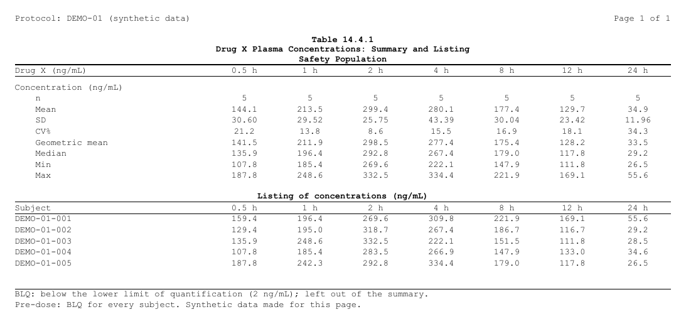
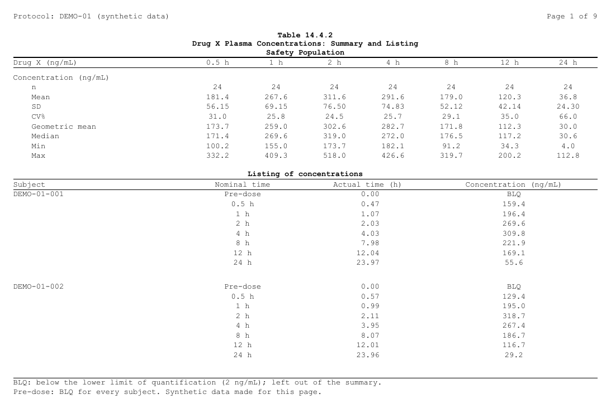
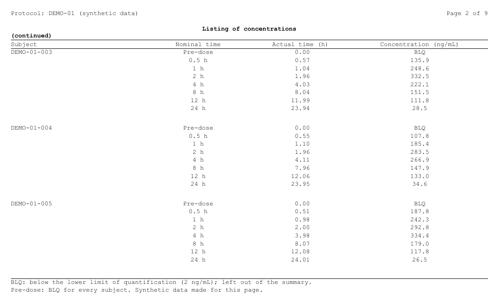

```{r, include = FALSE}
# A chunk's code sits under "Show code": open when it is what the page is
# about (`fold = "open"`), closed when it only supports it (`fold = "closed"`,
# the default unless the page sets another); `fold = FALSE` shows it plain,
# and so is code of three lines or fewer.
# Its results stay outside, always shown.
.fold_src <- knitr::knit_hooks$get("source")
knitr::knit_hooks$set(source = function(x, options) {
  f <- if (is.null(options$fold)) "closed" else options$fold
  if (isFALSE(f) || length(unlist(strsplit(x, "\n", fixed = TRUE))) <= 3L) {
    return(.fold_src(x, options))
  }
  paste0("\n\n<details", if (identical(f, "open")) " open", ">",
         "<summary>Show code</summary>\n\n",
         .fold_src(x, options), "\n\n</details>\n\n")
})
knitr::opts_chunk$set(fold = "open")   # this page: the code is the subject
knitr::opts_chunk$set(collapse = TRUE, comment = "#>",
                      message = FALSE, warning = FALSE)
options(width = 100)
# The files are written in a folder of their own: RTFREPORTER_ARTICLE_OUT
# when data-raw/gen_several_contents.R renders the page (it makes the
# pictures from them), a temporary one otherwise.  The pictures are
# committed in img/several-contents/ beside this page, so they show on
# GitHub too.
knitr::opts_knit$set(root.dir = Sys.getenv("RTFREPORTER_ARTICLE_OUT", tempdir()))
```

<p align="right">
  <a class="btn btn-outline-secondary btn-sm" href="several-contents.html">In English</a>
</p>

帳票では、1 ページに 2 つのコンテンツを置くことがよくあります。集計表とその元のリスティング、
表とその図、短い表 2 つなどです。rtfreporter では `rtf_tables()` や `rtf_figures()` を
1 回呼ぶごとにコンテンツが 1 つ足され、`page_break = FALSE` を付けると、新しいページではなく
前のコンテンツの下に続きます。この記事では、そうした帳票を 4 つ作り、その決まりを説明します。

```{r setup, fold = FALSE}
library(rtfreporter)
```

## 引数

| 引数 | 関数 | 働き |
|---|---|---|
| `page_break` | `rtf_tables()`, `rtf_figures()` | `TRUE`（既定）: コンテンツは新しいページから始まる。`FALSE`: 前のコンテンツの下に続く。 |
| `space_before` | 両方 | `page_break = FALSE` の時、2 つの間の空行の数。 |
| `titles`, `footnotes` | 両方 | そのコンテンツのタイトル（上）と脚注（下）。 |
| `first_rows` | `rtf_tables()` | `page_break = FALSE` の時、共有するページに載せる表の行数。残りは表のページ分け（plan の `plan_paginate_rows()`）のとおりに分かれ、各ページにタイトル・列見出し・脚注が付く。 |
| `cont_title` | `rtf_tables()` | `first_rows` の時、2 ページ目からのタイトルの下に足す 1 行（`"(continued)"` など）。 |

ページのヘッダーとフッター（`rtf_section(header = , footer = )`）は、コンテンツではなくページの物です。
何が載っていても、どのページにも出ます。

**1 ページに収めるのはプログラムの役目です。** rtfreporter はページの高さを測りません。
入りきらないコンテンツは、読む側（Word、LibreOffice）が次のページへ送ります。そのページには
タイトルも列見出しも脚注も付かず、ファイルに書いたページ番号（`{PAGE}` / `{TOTAL_PAGES}`）も
ずれます。入る量を数えてください。1 つ目のコンテンツを短くする、図に高さを与える、長い表には
`first_rows` を付ける、などです。この記事の後半の `rtf_layout()` で、rtfreporter が書き出す
ページを確かめられます。

## (a) 表の下に表

同じ集団の 2 つの集計です。それぞれ自分の ARD と plan から作ります。人口統計と、被験者の内訳（中止理由など）です。

```{r a-data, fold = "closed"}
adsl <- cards::ADSL
adsl$ARM <- factor(adsl$ARM, levels = c("Placebo", "Xanomeline Low Dose",
                                        "Xanomeline High Dose"))
ard_dm <- cards::ard_stack(
  adsl, .by = ARM,
  cards::ard_summary(variables = AGE),
  cards::ard_tabulate(variables = c(AGEGR1, SEX)))
ard_ds <- cards::ard_stack(
  adsl, .by = ARM,
  cards::ard_tabulate(variables = DCDECOD))

# the column header both tables share: the arm and its N
arm_header <- rtf_col_header(c("", "{col}"), c("", "(N={n})"))
dm <- ard_dm |>
  normalize_ard() |>
  table_plan(cols = "ARM", rows = c(group = "variable")) |>
  plan_cells(continuous = c("n" = "{N:.0f}", "Mean (SD)" = "{mean:.1f} ({sd:.2f})",
                            "Min, Max" = "{min:.0f}, {max:.0f}"),
             categorical = "{n:.0f} ({p:.1f%})", notes = FALSE) |>
  plan_labels(c(AGE = "Age (years)", AGEGR1 = "Age group, n (%)", SEX = "Sex, n (%)")) |>
  plan_levels(AGEGR1 = c("<65", "65-80", ">80"), SEX = c("F", "M")) |>
  plan_col_header(values = list(n = TRUE), arm_header) |>
  plan_stub(name = "row_label") |>
  plan_columns(widths = c(4, 2, 2, 2)) |>
  plan_style(border = "tfl", align_count_pct = TRUE)
ds <- ard_ds |>
  normalize_ard() |>
  table_plan(cols = "ARM", rows = c(group = "variable")) |>
  plan_cells(categorical = "{n:.0f} ({p:.1f%})", notes = FALSE) |>
  plan_labels(c(DCDECOD = "Disposition, n (%)")) |>
  plan_col_header(values = list(n = TRUE), arm_header) |>
  plan_stub(name = "row_label") |>
  plan_columns(widths = c(4, 2, 2, 2)) |>
  plan_style(border = "tfl", align_count_pct = TRUE)
```

1 つ目の `rtf_tables()` がページを始め、`page_break = FALSE` の 2 つ目はその下に、
空行 1 つをはさんで続きます:

```{r a-doc}
header <- rtf_header(list(c(l = "Protocol: CDISCPILOT01", r = "Page {PAGE} of {TOTAL_PAGES}")))
doc_a <- rtf_document() |>
  rtf_section(header = header) |>
  rtf_tables(dm, titles = list(c("Table 14.1.1",
                                 "Demographics and Disposition",
                                 "Intent-to-Treat Population")),
             footnotes = list("Percentages are of the subjects in the arm.")) |>
  rtf_tables(ds, page_break = FALSE, space_before = 1L,
             titles = list("Disposition"),
             footnotes = list("Source: ADSL."))
generate_rtfreport(doc_a, "a_table_table.rtf", overwrite = TRUE)
```


どちらの表も自分のタイトルと脚注を持ちます。出力全体のタイトル（表番号、表題、集団）は
1 つ目のコンテンツのタイトルに書きます。出力全体の脚注は最後のコンテンツの脚注に書きます。
どのページにも出したい時は、ページのフッターに書きます。

## (b) 表の下に図

`rtf_figures()` も同じ `page_break` と `space_before` を取ります。図の高さは、ページの残りに合わせて決めます:

```{r b-doc}
library(ggplot2)
age_plot <- ggplot(adsl, aes(ARM, AGE)) +
  geom_boxplot() +
  labs(x = NULL, y = "Age (years)") +
  theme_bw(base_size = 9)
doc_b <- rtf_document() |>
  rtf_section(header = header) |>
  rtf_tables(dm, titles = list(c("Table 14.1.2", "Age by Arm",
                                 "Intent-to-Treat Population"))) |>
  rtf_figures(age_plot, page_break = FALSE, space_before = 1L,
              render_width = 6, render_height = 2.6,
              titles = list("Figure: age by arm"),
              footnotes = list("Box: quartiles; whiskers: 1.5 IQR."))
generate_rtfreport(doc_b, "b_table_figure.rtf", overwrite = TRUE)
```


## (c) PK 濃度の集計表とリスティング

時点ごとの濃度の集計表と、その下に同じ濃度のリスティングを置きます。どちらも時点を横に並べ、
集計表の行は統計量、リスティングの行は被験者です。データはここで作る合成の物です。24 人、8 時点、
1-コンパートメントの曲線に誤差を足し、2 ng/mL 未満は BLQ です。この例ではそのうち 5 人を使います。
時点を横に並べるので、集計表とリスティングが 1 ページに収まります。(d) では 24 人全員を使います。

```{r c-data, fold = "closed"}
set.seed(20261028)
n_subj <- 24
tpt <- data.frame(ATPTN = c(0, 0.5, 1, 2, 4, 8, 12, 24),
                  ATPT  = c("Pre-dose", "0.5 h", "1 h", "2 h", "4 h", "8 h", "12 h", "24 h"))
subj <- data.frame(USUBJID = sprintf("DEMO-01-%03d", seq_len(n_subj)),
                   ka   = stats::rlnorm(n_subj, log(1.2), 0.25),
                   ke   = stats::rlnorm(n_subj, log(0.12), 0.25),
                   dose = stats::rlnorm(n_subj, log(400), 0.20))
adpc <- merge(subj, tpt, by = NULL)
adpc <- adpc[order(adpc$USUBJID, adpc$ATPTN), ]
conc <- with(adpc, dose * ka / (ka - ke) * (exp(-ke * ATPTN) - exp(-ka * ATPTN)))
conc <- conc * stats::rlnorm(nrow(adpc), 0, 0.12)
adpc$ARELTM <- round(pmax(0, adpc$ATPTN +
  ifelse(adpc$ATPTN == 0, -0.1, stats::runif(nrow(adpc), -0.08, 0.12))), 2)
blq <- adpc$ATPTN == 0 | conc < 2
adpc$AVAL  <- ifelse(blq, NA_real_, round(conc, 1))
adpc$AVALC <- ifelse(blq, "BLQ", format(round(conc, 1), nsmall = 1, trim = TRUE))
adpc$ATPT  <- factor(adpc$ATPT, levels = tpt$ATPT)
```

集計表は時点ごとの ARD から作り、時点を横に並べます。BLQ の検体は除き、投与前（全員 BLQ）の列は
ありません。plan は 1 つの関数で作り、(d) では 24 人全員に使います:

```{r c-summary}
cv <- function(x) 100 * stats::sd(x) / mean(x)
gm <- function(x) exp(mean(log(x)))
pk_summary_plan <- function(data, cells) {
  ard <- cards::ard_summary(
    droplevels(data[!is.na(data$AVAL), ]), by = ATPT, variables = AVAL,
    statistic = ~ list(N = length, mean = mean, sd = stats::sd, cv = cv,
                       geo_mean = gm, median = stats::median, min = min, max = max))
  ard |>
    normalize_ard() |>
    table_plan(cols = "ATPT", rows = c(group = "variable")) |>
    plan_cells(continuous = cells, notes = FALSE) |>
    plan_labels(c(AVAL = "Concentration (ng/mL)")) |>
    plan_levels(ATPT = tpt$ATPT[-1]) |>
    plan_col_header(rtf_col_header(c("Drug X (ng/mL)", "{col}"))) |>
    plan_stub(name = "row_label") |>
    plan_columns(widths = c(3, rep(1, nrow(tpt) - 1))) |>
    plan_style(border = "tfl")
}
pk_cells <- c("n" = "{N:.0f}", "Mean" = "{mean:.1f}", "SD" = "{sd:.2f}",
              "CV%" = "{cv:.1f}", "Geometric mean" = "{geo_mean:.1f}",
              "Median" = "{median:.1f}", "Min" = "{min:.1f}", "Max" = "{max:.1f}")
pk5 <- adpc[adpc$USUBJID %in% unique(adpc$USUBJID)[1:5], ]
summary5 <- pk_summary_plan(pk5, pk_cells)
```

リスティングは集計表と同じ形にします。行が被験者、列が時点、セルが濃度です（下限未満は `BLQ`）。
ふつうのデータフレームで、列名が見出しになります。列幅を集計表と同じにして、2 つの列をそろえます:

```{r c-listing}
post <- pk5[pk5$ATPT != "Pre-dose", ]
listing5 <- data.frame(Subject = unique(post$USUBJID))
for (t in tpt$ATPT[-1]) {
  at <- post[post$ATPT == t, ]
  listing5[[t]] <- at$AVALC[match(listing5$Subject, at$USUBJID)]
}
listing5_plan <- table_plan(listing5) |>
  plan_columns(widths = c(3, rep(1, nrow(tpt) - 1))) |>
  plan_style(border = "tfl")
listing5
```

集計表がページを始めて出力のタイトルを持ち、リスティングはその下に続きます:

```{r c-doc}
pk_header <- rtf_header(list(
  c(l = "Protocol: {STUDY} (synthetic data)", r = "Page {PAGE} of {TOTAL_PAGES}")))
pk_footer <- rtf_footer(list(
  c(l = "BLQ: below the lower limit of quantification (2 ng/mL); left out of the summary."),
  c(l = "Pre-dose: BLQ for every subject. Synthetic data made for this page.")))
doc_c <- rtf_document(tokens = list(STUDY = "DEMO-01")) |>
  rtf_section(header = pk_header, footer = pk_footer) |>
  rtf_tables(summary5,
             titles = list(c("Table 14.4.1",
                             "Drug X Plasma Concentrations: Summary and Listing",
                             "Safety Population"))) |>
  rtf_tables(listing5_plan, page_break = FALSE, space_before = 1L,
             titles = list("Listing of concentrations (ng/mL)"))
generate_rtfreport(doc_c, "c_pk.rtf", overwrite = TRUE)
```



## (d) 長いリスティングの続き

24 人全員では、リスティングは集計表の下の残りより長くなります。ここでは 1 行が 1 検体のふつうの表として
書きます。列は印刷する形にし、列名を見出しにします。`plan_row_group()` は被験者番号を最初の行だけに出し
（ページの頭では出し直す）、`plan_blanks()` は被験者の間に空行を入れ、`plan_paginate_rows()` は被験者の
途中で切らずに 1 ページ 24 行（3 人分）に分けます:

```{r d-listing}
pk_summary <- pk_summary_plan(adpc, pk_cells)
lst <- data.frame(Subject = adpc$USUBJID,
                  `Nominal time` = as.character(adpc$ATPT),
                  `Actual time (h)` = format(adpc$ARELTM, nsmall = 2),
                  `Concentration (ng/mL)` = adpc$AVALC,
                  check.names = FALSE)
pk_listing <- table_plan(lst) |>
  plan_row_group(mode = "value", collapse = "Subject", group_col = "Subject") |>
  plan_blanks(where = "between_groups") |>
  plan_paginate_rows(max_rows = 24, split = "group_safe") |>
  plan_columns(widths = c(2, 1.5, 1.5, 2)) |>
  plan_style(border = "tfl")
```

（`plan_listing()` と `listing_spec()` は、有害事象のように 1 件が何行にも折り返すリスティング向けで、
1 件ごとに空行が入ります。[Listings with a plan](plan-listings.html) を見てください。）

`first_rows` で、共有するページに載せるリスティングの行数を書きます（データの行数で、被験者の間の空行は
数えません）。残りは plan のページ分けのとおりに自分のページへ続き、各ページにリスティングのタイトル、
`cont_title` の行、列見出し、脚注が付きます:

```{r d-doc}
doc_pk <- rtf_document(tokens = list(STUDY = "DEMO-01")) |>
  rtf_section(header = pk_header, footer = pk_footer) |>
  rtf_tables(pk_summary,
             titles = list(c("Table 14.4.2",
                             "Drug X Plasma Concentrations: Summary and Listing",
                             "Safety Population"))) |>
  rtf_tables(pk_listing, page_break = FALSE, space_before = 1L,
             first_rows = 16L, cont_title = "(continued)",
             titles = list("Listing of concentrations"))
generate_rtfreport(doc_pk, "d_pk.rtf", overwrite = TRUE)
```

1 ページ目: 集計表と、リスティングの最初の 16 行:



2 ページ目: リスティングの続き:



この例の脚注はページのフッターに入れたので、どのページにも出ます。`rtf_tables(footnotes = )` に
書いた脚注はそのコンテンツの物で、そのコンテンツの各ページで、その下に出ます。

## ページを確かめる: `rtf_layout()`

`rtf_layout()` は、`generate_rtfreport()` が書き出すとおりにページを組みます（ファイルは書きません）。
各ページのコンテンツを 1 行ずつ、表の行数と図の大きさとともに示します。1 ページに載る量を数え、
コンテンツがどこで切れるかを確かめるのに使います:

```{r layout}
rtf_layout(doc_pk)
```

結果はリストでもあります。`rtf_layout(doc)$pages` は印刷するページごとに 1 つで、それぞれの
`segments` がそのページのコンテンツ（上から順）です。

## 複数のコンテンツがあるページのセクション

`rtf_tables(auto_section = TRUE)` は名前の付いたコンテンツごとにセクションを開き、ヘッダーとフッターの値を
変えられるようにします。ページのヘッダーとフッターは 1 つなので、複数のコンテンツがあるページのセクションも 1 つです:

* ページのセクションは、**そのページで最初にセクションを持つコンテンツ**の物です。
* 同じページの後のコンテンツが違うセクションを持つと warning が出て、そのセクションは使われません。そのために改ページは足しません。
* どのコンテンツもセクションを持たないページは、前のページのセクションを続けます。

```{r sections}
df <- function(n) data.frame(Item = sprintf("Row %02d", seq_len(n)), N = seq_len(n))
doc_s <- rtf_document() |>
  rtf_tables(list(Overview = df(3)), titles = "Table 1") |>
  rtf_tables(list("Part B" = df(4)), titles = "Table 2", auto_section = TRUE,
             page_break = FALSE)
rtf_layout(doc_s)
```

1 つ目の表はセクションを持たないので、ページは 2 つ目の "Part B" になります。改ページは
`page_break` と表自身のページ分けだけで決まります。

## タイトルやヘッダーにページの値を入れる: `{列名}`

列の値でページを分けた表（`as_rtftables(page_by = )`、plan の `plan_paginate_group()`）は、
各ページのその列の値を知っています。タイトル・脚注・ヘッダー・フッターに `{列名}` と書くと、その値が入ります:

```{r tokens}
lab <- data.frame(PARAM = rep(c("ALT (U/L)", "AST (U/L)"), each = 3),
                  Visit = rep(c("Baseline", "Week 2", "Week 4"), 2),
                  Mean  = c(21.3, 22.0, 21.8, 24.1, 24.9, 25.2))
pages <- as_rtftables(lab, page_by = "PARAM", drop_cols = "PARAM")
doc_t <- rtf_document() |>
  rtf_section(header = rtf_header(list(c(l = "Parameter: {PARAM}",
                                         r = "Page {PAGE} of {TOTAL_PAGES}")))) |>
  rtf_tables(pages, titles = list(c("Table 14.3.1", "Mean of {PARAM} by Visit")))
rtf_layout(doc_t)
rtf_layout(doc_t)$pages[[2]]$values     # the values of page 2
generate_rtfreport(doc_t, "t_tokens.rtf", overwrite = TRUE)
```


複数のコンテンツがあるページでは、タイトルと脚注は自分の表の値を取るので、それぞれが自分の値を書きます。
ヘッダーとフッターはページの物で、列ごとに、そのページで最初に値を持つ表の値を取ります。後の表が違う値を
持つと warning が出ます（上のセクションと同じ決まり）。ページに値の無い `{名前}` は書いたまま出ます。
rtfreporter の token（`{PAGE}`、`{PROGRAM}` など）と `rtf_document(tokens = )` で渡した token は、
同じ名前の列より優先します。

## 次に読む

- [Titles, footnotes and several tables](adding-content.html) --- タイトルと脚注の書き方と体裁
- [Headers, footers and tokens](headers-footers.html) --- ページのヘッダー・フッターと token
- [Splitting a report into sections](section-splitting.html) --- セクションと `auto_section`
- [Listings with a plan](plan-listings.html) --- 折り返すリスティング
