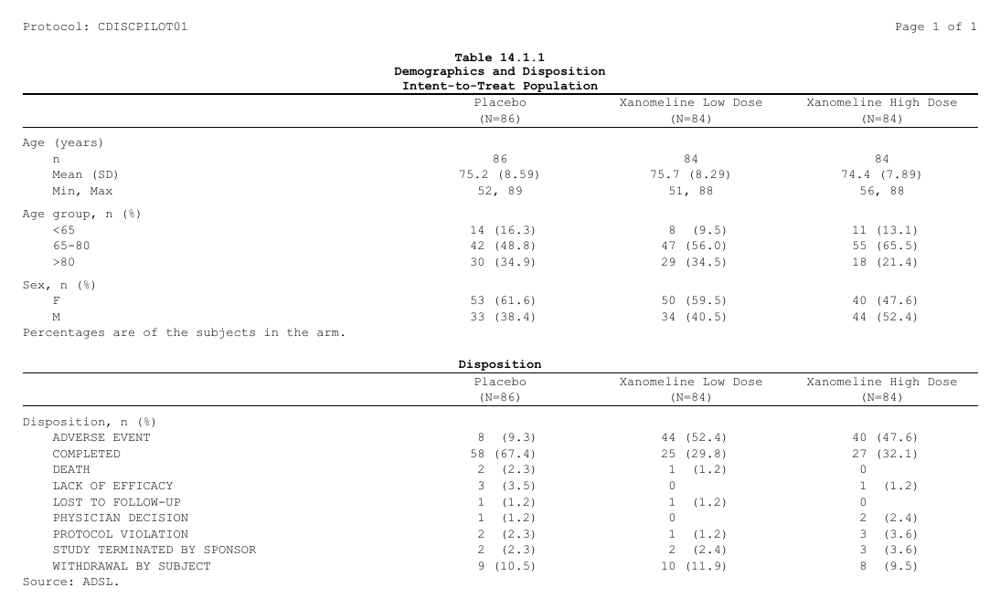
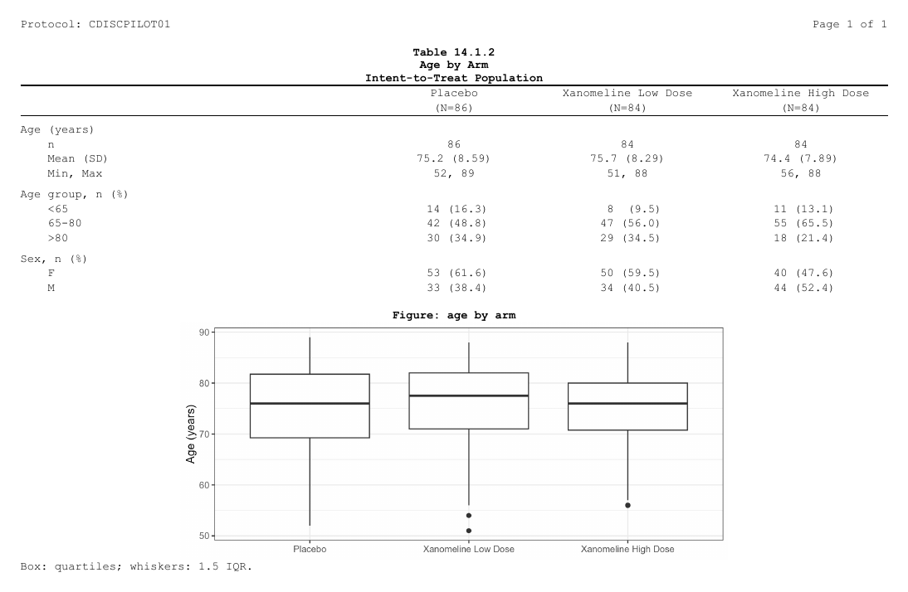
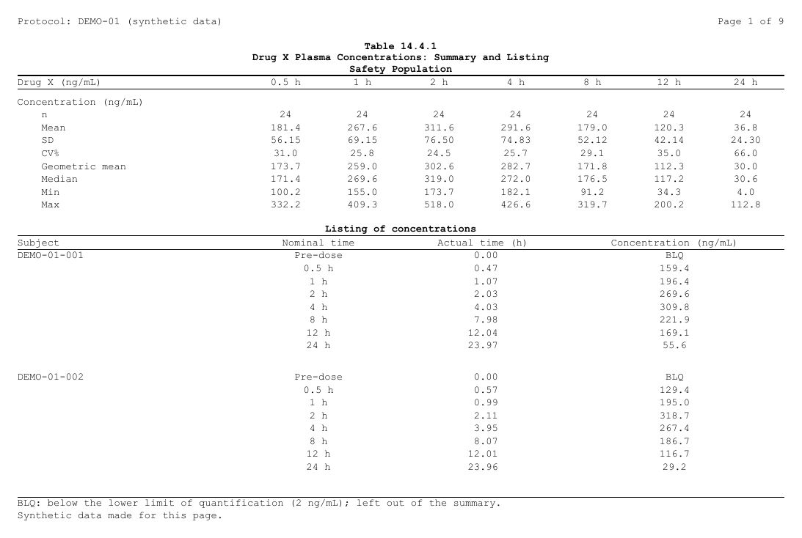
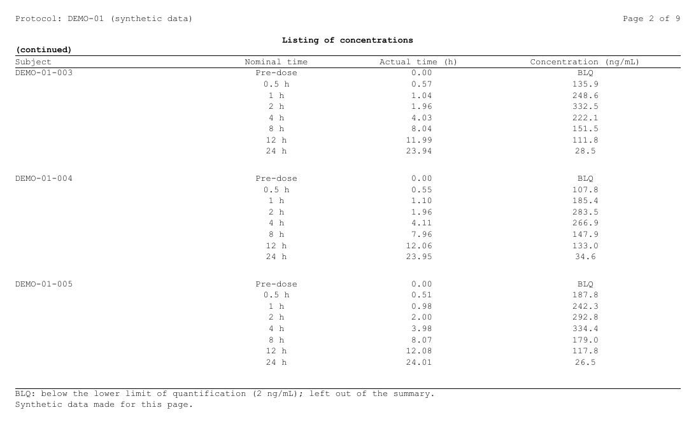
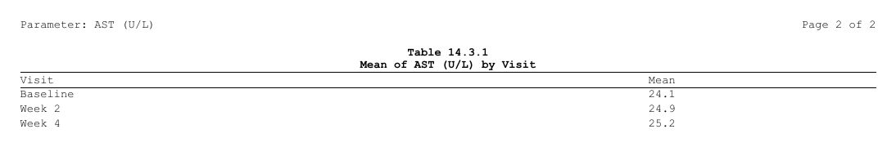

```{r, include = FALSE}
# A chunk's code sits under "Show code": open when it is what the page is
# about (`fold = "open"`), closed when it only supports it (`fold = "closed"`,
# the default unless the page sets another); `fold = FALSE` shows it plain,
# and so is code of three lines or fewer.
# Its results stay outside, always shown.
.fold_src <- knitr::knit_hooks$get("source")
knitr::knit_hooks$set(source = function(x, options) {
  f <- if (is.null(options$fold)) "closed" else options$fold
  if (isFALSE(f) || length(unlist(strsplit(x, "\n", fixed = TRUE))) <= 3L) {
    return(.fold_src(x, options))
  }
  paste0("\n\n<details", if (identical(f, "open")) " open", ">",
         "<summary>Show code</summary>\n\n",
         .fold_src(x, options), "\n\n</details>\n\n")
})
knitr::opts_chunk$set(fold = "open")   # this page: the code is the subject
knitr::opts_chunk$set(collapse = TRUE, comment = "#>",
                      message = FALSE, warning = FALSE)
options(width = 100)
# The files are written in a folder of their own: RTFREPORTER_ARTICLE_OUT
# when data-raw/gen_several_contents.R renders the page (it makes the
# pictures from them), a temporary one otherwise.  The pictures are
# committed in img/several-contents/ beside this page, so they show on
# GitHub too.
knitr::opts_knit$set(root.dir = Sys.getenv("RTFREPORTER_ARTICLE_OUT", tempdir()))
```

<p align="right">
  <a class="btn btn-outline-secondary btn-sm" href="several-contents-ja.html">In Japanese</a>
</p>

A report often puts two contents on one page: a summary table and the
listing behind it, a table and its figure, two short tables. In rtfreporter
each `rtf_tables()` or `rtf_figures()` call adds a content, and
`page_break = FALSE` puts it under the content before it instead of on a new
page. This page shows four such reports and the rules behind them.

```{r setup, fold = FALSE}
library(rtfreporter)
```

## The arguments

| Argument | Of | What it does |
|---|---|---|
| `page_break` | `rtf_tables()`, `rtf_figures()` | `TRUE` (the default): the content starts a page. `FALSE`: it goes on under the content before it. |
| `space_before` | both | With `page_break = FALSE`, the empty lines between the two. |
| `titles`, `footnotes` | both | The content's own title block (above it) and footnote block (under it). |
| `first_rows` | `rtf_tables()` | With `page_break = FALSE`, the rows of the table that go on the shared page. The rest is paginated as the table says (a plan's `plan_paginate_rows()`), each page with its title, column header and footnote. |
| `cont_title` | `rtf_tables()` | With `first_rows`, a line under the title of each later page, such as `"(continued)"`. |

The header and footer of the page (`rtf_section(header = , footer = )`) are
the page's, not a content's: they print on every page whatever is on it.

**Fitting the page is the program's job.** rtfreporter does not measure the
page. A content that does not fit is carried to the next page by the reader
(Word, LibreOffice), with no title, column header or footnote there, and the
page numbers written into the file (`{PAGE}` / `{TOTAL_PAGES}`) are then
off. Count what fits: make the first content short enough, give a figure its
height, and give a long table `first_rows`. `rtf_layout()`, at the end of
this page, shows the pages as rtfreporter will write them.

## (a) A table under a table

Two summaries of one population, each from its own ARD and plan:
demographics, and the subjects' disposition.

```{r a-data, fold = "closed"}
adsl <- cards::ADSL
adsl$ARM <- factor(adsl$ARM, levels = c("Placebo", "Xanomeline Low Dose",
                                        "Xanomeline High Dose"))
ard_dm <- cards::ard_stack(
  adsl, .by = ARM,
  cards::ard_summary(variables = AGE),
  cards::ard_tabulate(variables = c(AGEGR1, SEX)))
ard_ds <- cards::ard_stack(
  adsl, .by = ARM,
  cards::ard_tabulate(variables = DCDECOD))

# the column header both tables share: the arm and its N
arm_header <- rtf_col_header(c("", "{col}"), c("", "(N={n})"))
dm <- ard_dm |>
  normalize_ard() |>
  table_plan(cols = "ARM", rows = c(group = "variable")) |>
  plan_cells(continuous = c("n" = "{N:.0f}", "Mean (SD)" = "{mean:.1f} ({sd:.2f})",
                            "Min, Max" = "{min:.0f}, {max:.0f}"),
             categorical = "{n:.0f} ({p:.1f%})", notes = FALSE) |>
  plan_labels(c(AGE = "Age (years)", AGEGR1 = "Age group, n (%)", SEX = "Sex, n (%)")) |>
  plan_levels(AGEGR1 = c("<65", "65-80", ">80"), SEX = c("F", "M")) |>
  plan_col_header(values = list(n = TRUE), arm_header) |>
  plan_stub(name = "row_label") |>
  plan_columns(widths = c(4, 2, 2, 2)) |>
  plan_style(border = "tfl", align_count_pct = TRUE)
ds <- ard_ds |>
  normalize_ard() |>
  table_plan(cols = "ARM", rows = c(group = "variable")) |>
  plan_cells(categorical = "{n:.0f} ({p:.1f%})", notes = FALSE) |>
  plan_labels(c(DCDECOD = "Disposition, n (%)")) |>
  plan_col_header(values = list(n = TRUE), arm_header) |>
  plan_stub(name = "row_label") |>
  plan_columns(widths = c(4, 2, 2, 2)) |>
  plan_style(border = "tfl", align_count_pct = TRUE)
```

The first `rtf_tables()` starts the page; the second, with
`page_break = FALSE`, goes on under it, one empty line between them:

```{r a-doc}
header <- rtf_header(list(c(l = "Protocol: CDISCPILOT01", r = "Page {PAGE} of {TOTAL_PAGES}")))
doc_a <- rtf_document() |>
  rtf_section(header = header) |>
  rtf_tables(dm, titles = list(c("Table 14.1.1",
                                 "Demographics and Disposition",
                                 "Intent-to-Treat Population")),
             footnotes = list("Percentages are of the subjects in the arm.")) |>
  rtf_tables(ds, page_break = FALSE, space_before = 1L,
             titles = list("Disposition"),
             footnotes = list("Source: ADSL."))
generate_rtfreport(doc_a, "a_table_table.rtf", overwrite = TRUE)
```



Each table keeps its own title and footnote. The output's own title (the
table number, its name and the population) is the first content's title
block; a footnote for the whole output is the last content's footnote block,
or the page footer when it is wanted on every page.

## (b) A figure under a table

`rtf_figures()` takes the same `page_break` and `space_before`. Give the
figure the height that is left on the page:

```{r b-doc}
library(ggplot2)
age_plot <- ggplot(adsl, aes(ARM, AGE)) +
  geom_boxplot() +
  labs(x = NULL, y = "Age (years)") +
  theme_bw(base_size = 9)
doc_b <- rtf_document() |>
  rtf_section(header = header) |>
  rtf_tables(dm, titles = list(c("Table 14.1.2", "Age by Arm",
                                 "Intent-to-Treat Population"))) |>
  rtf_figures(age_plot, page_break = FALSE, space_before = 1L,
              render_width = 6, render_height = 2.6,
              titles = list("Figure: age by arm"),
              footnotes = list("Box: quartiles; whiskers: 1.5 IQR."))
generate_rtfreport(doc_b, "b_table_figure.rtf", overwrite = TRUE)
```



## (c) A PK summary and its listing

A concentration summary by time point, and under it the listing of the same
concentrations. The data is made up here: 24 subjects, 8 nominal times, a
one-compartment curve with some noise, BLQ under 2 ng/mL.

```{r c-data, fold = "closed"}
set.seed(20261028)
n_subj <- 24
tpt <- data.frame(ATPTN = c(0, 0.5, 1, 2, 4, 8, 12, 24),
                  ATPT  = c("Pre-dose", "0.5 h", "1 h", "2 h", "4 h", "8 h", "12 h", "24 h"))
subj <- data.frame(USUBJID = sprintf("DEMO-01-%03d", seq_len(n_subj)),
                   ka   = stats::rlnorm(n_subj, log(1.2), 0.25),
                   ke   = stats::rlnorm(n_subj, log(0.12), 0.25),
                   dose = stats::rlnorm(n_subj, log(400), 0.20))
adpc <- merge(subj, tpt, by = NULL)
adpc <- adpc[order(adpc$USUBJID, adpc$ATPTN), ]
conc <- with(adpc, dose * ka / (ka - ke) * (exp(-ke * ATPTN) - exp(-ka * ATPTN)))
conc <- conc * stats::rlnorm(nrow(adpc), 0, 0.12)
adpc$ARELTM <- round(pmax(0, adpc$ATPTN +
  ifelse(adpc$ATPTN == 0, -0.1, stats::runif(nrow(adpc), -0.08, 0.12))), 2)
blq <- adpc$ATPTN == 0 | conc < 2
adpc$AVAL  <- ifelse(blq, NA_real_, round(conc, 1))
adpc$AVALC <- ifelse(blq, "BLQ", format(round(conc, 1), nsmall = 1, trim = TRUE))
adpc$ATPT  <- factor(adpc$ATPT, levels = tpt$ATPT)
```

The summary is an ARD by time point, the time points across. BLQ samples are
left out, so pre-dose (all BLQ) has no column:

```{r c-summary}
cv <- function(x) 100 * stats::sd(x) / mean(x)
gm <- function(x) exp(mean(log(x)))
ard_pc <- cards::ard_summary(
  droplevels(adpc[!is.na(adpc$AVAL), ]), by = ATPT, variables = AVAL,
  statistic = ~ list(N = length, mean = mean, sd = stats::sd, cv = cv,
                     geo_mean = gm, median = stats::median, min = min, max = max))
pk_summary <- ard_pc |>
  normalize_ard() |>
  table_plan(cols = "ATPT", rows = c(group = "variable")) |>
  plan_cells(continuous = c("n" = "{N:.0f}", "Mean" = "{mean:.1f}", "SD" = "{sd:.2f}",
                            "CV%" = "{cv:.1f}", "Geometric mean" = "{geo_mean:.1f}",
                            "Median" = "{median:.1f}", "Min" = "{min:.1f}",
                            "Max" = "{max:.1f}"),
             notes = FALSE) |>
  plan_labels(c(AVAL = "Concentration (ng/mL)")) |>
  plan_levels(ATPT = tpt$ATPT[-1]) |>
  plan_col_header(rtf_col_header(c("Drug X (ng/mL)", "{col}"))) |>
  plan_stub(name = "row_label") |>
  plan_columns(widths = c(3, rep(1, nrow(tpt) - 1))) |>
  plan_style(border = "tfl")
```

The listing has one row a sample, so it is written as a plain table: the
columns as they print, named as their headers. `plan_row_group()` prints the
subject on its first row only (and again at the top of a page),
`plan_blanks()` puts a blank row between subjects, and
`plan_paginate_rows()` makes pages of 24 rows (three subjects) without
cutting a subject:

```{r c-listing}
lst <- data.frame(Subject = adpc$USUBJID,
                  `Nominal time` = as.character(adpc$ATPT),
                  `Actual time (h)` = format(adpc$ARELTM, nsmall = 2),
                  `Concentration (ng/mL)` = adpc$AVALC,
                  check.names = FALSE)
pk_listing <- table_plan(lst) |>
  plan_row_group(mode = "value", collapse = "Subject", group_col = "Subject") |>
  plan_blanks(where = "between_groups") |>
  plan_paginate_rows(max_rows = 24, split = "group_safe") |>
  plan_columns(widths = c(2, 1.5, 1.5, 2)) |>
  plan_style(border = "tfl")
```

(`plan_listing()` and `listing_spec()` are for listings whose records wrap
over several lines, such as adverse events; they put a blank row after every
record. See [Listings with a plan](plan-listings.html).)

## (d) A long listing that goes on

The listing is longer than what is left under the summary. `first_rows`
says how many of its rows go on the shared page (rows of data: the blank
rows between subjects come on top); the rest goes on pages of its own,
paginated by its plan, each with the listing's title, the `cont_title`
line, the column header and the footnote:

```{r d-doc}
doc_pk <- rtf_document(tokens = list(STUDY = "DEMO-01")) |>
  rtf_section(
    header = rtf_header(list(
      c(l = "Protocol: {STUDY} (synthetic data)", r = "Page {PAGE} of {TOTAL_PAGES}"))),
    footer = rtf_footer(list(
      c(l = "BLQ: below the lower limit of quantification (2 ng/mL); left out of the summary."),
      c(l = "Synthetic data made for this page.")))) |>
  rtf_tables(pk_summary,
             titles = list(c("Table 14.4.1",
                             "Drug X Plasma Concentrations: Summary and Listing",
                             "Safety Population"))) |>
  rtf_tables(pk_listing, page_break = FALSE, space_before = 1L,
             first_rows = 16L, cont_title = "(continued)",
             titles = list("Listing of concentrations"))
generate_rtfreport(doc_pk, "c_pk.rtf", overwrite = TRUE)
```

Page 1, the summary and the first 16 rows of the listing:



Page 2, where the listing goes on:



The footnotes here are in the page footer, so they print on every page. A
footnote given to `rtf_tables(footnotes = )` belongs to that content and
prints under it, on each of its pages.

## Checking the pages: `rtf_layout()`

`rtf_layout()` lays the document out as `generate_rtfreport()` will write
it, without writing it: one line per content on each page, with the rows of
each table and the size of each figure. Use it to count what goes on a page
and to see where a content is cut:

```{r layout}
rtf_layout(doc_pk)
```

The result is a list as well: `rtf_layout(doc)$pages` has one entry per
printed page, each with its `segments` (the contents on it, top to bottom).

## Sections on a page of several contents

`rtf_tables(auto_section = TRUE)` opens a section for each named content, so
each can have its own header and footer values. A page has one header and
one footer, so a page of several contents has one section:

* the page takes the section of the **first content on it that has one**;
* a later content on the page with a different one gets a warning, and its
  section is not used: no page break is added for it;
* a page whose contents have none stays in the section before it.

```{r sections}
df <- function(n) data.frame(Item = sprintf("Row %02d", seq_len(n)), N = seq_len(n))
doc_s <- rtf_document() |>
  rtf_tables(list(Overview = df(3)), titles = "Table 1") |>
  rtf_tables(list("Part B" = df(4)), titles = "Table 2", auto_section = TRUE,
             page_break = FALSE)
rtf_layout(doc_s)
```

The first table has no section, so the page takes "Part B" from the second.
Page breaks come only from `page_break` and the tables' own pagination.

## A page's values in titles and headers: `{column}`

A table cut into pages on a column -- `as_rtftables(page_by = )`, a plan's
`plan_paginate_group()` -- knows each page's value of that column. A title,
footnote, header or footer writes `{<column name>}` and gets that value:

```{r tokens}
lab <- data.frame(PARAM = rep(c("ALT (U/L)", "AST (U/L)"), each = 3),
                  Visit = rep(c("Baseline", "Week 2", "Week 4"), 2),
                  Mean  = c(21.3, 22.0, 21.8, 24.1, 24.9, 25.2))
pages <- as_rtftables(lab, page_by = "PARAM", drop_cols = "PARAM")
doc_t <- rtf_document() |>
  rtf_section(header = rtf_header(list(c(l = "Parameter: {PARAM}",
                                         r = "Page {PAGE} of {TOTAL_PAGES}")))) |>
  rtf_tables(pages, titles = list(c("Table 14.3.1", "Mean of {PARAM} by Visit")))
rtf_layout(doc_t)
rtf_layout(doc_t)$pages[[2]]$values     # the values of page 2
generate_rtfreport(doc_t, "t_tokens.rtf", overwrite = TRUE)
```



On a page of several contents, a title or footnote takes the value of its
own table, so each names its own. The header and footer belong to the page:
each column takes the value of the first table on the page that has one,
and a later table with another value gets a warning (the rule of the
sections above). A `{NAME}` the page has no value for prints as written;
rtfreporter's own tokens (`{PAGE}`, `{PROGRAM}`, ...) and those given to
`rtf_document(tokens = )` win over a column of the same name.

## Where next

- [Titles, footnotes and several tables](adding-content.html) --- the title
  and footnote blocks, and styling them
- [Headers, footers and tokens](headers-footers.html) --- the page's own
  bands and the tokens they take
- [Splitting a report into sections](section-splitting.html) --- sections
  and `auto_section`
- [Listings with a plan](plan-listings.html) --- listings whose records wrap
