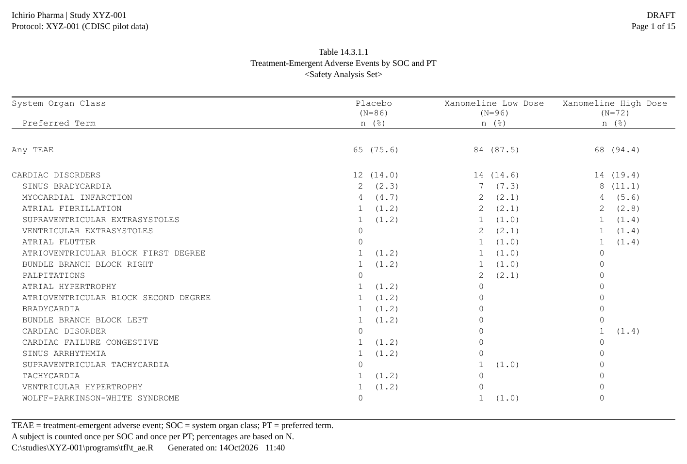
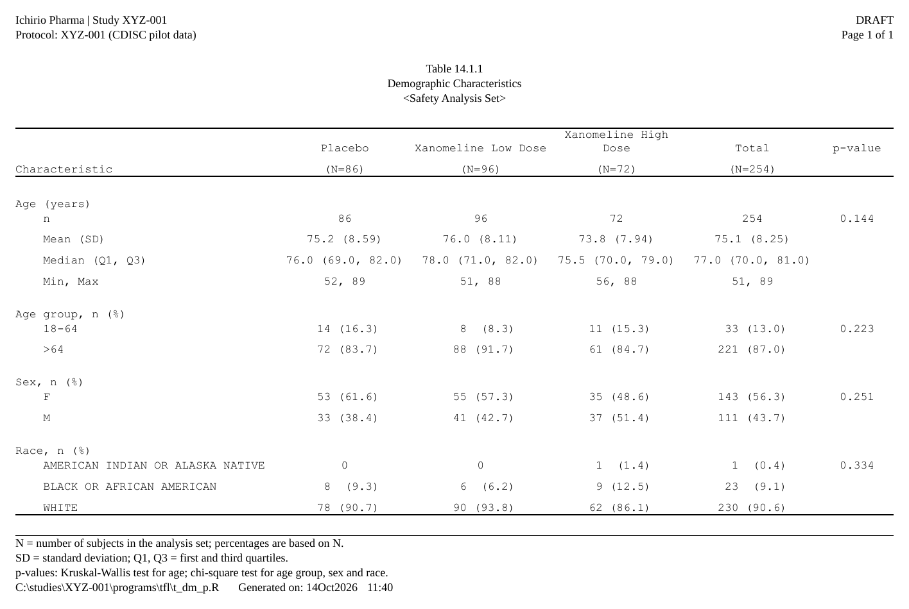
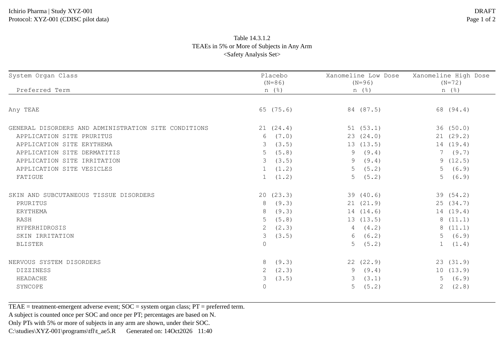
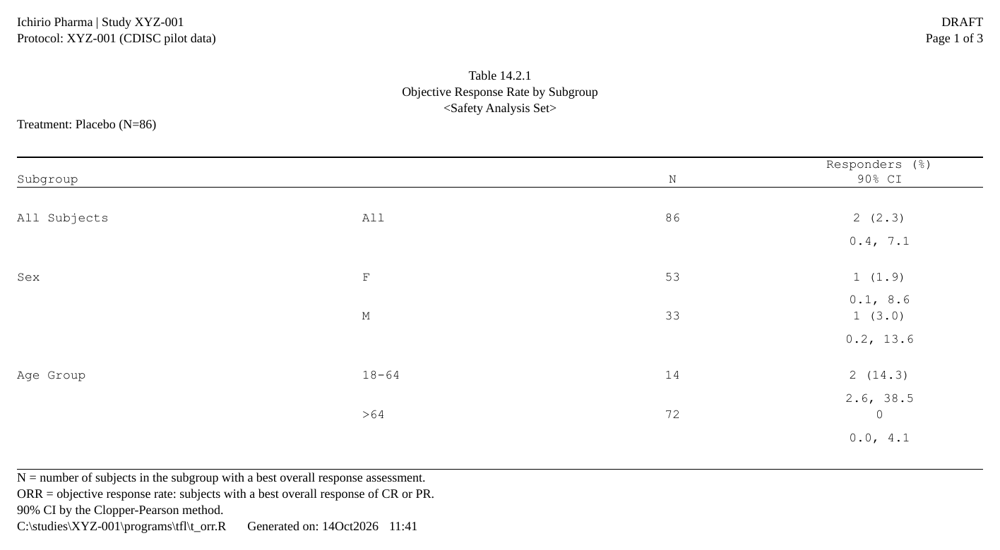

```{r, include = FALSE}
# The chunks below RUN.  Every file goes to a temporary folder, so building
# this vignette writes nothing outside the session, and a broken example fails
# the build instead of rotting unnoticed.  The ARD chunks need cards.
# data-raw/gen_gallery.R points RTFREPORTER_ARTICLE_OUT at the folder whose
# t_ae.rtf becomes the picture of the adverse-events table.
has_cards <- requireNamespace("cards", quietly = TRUE)
knitr::opts_chunk$set(collapse = TRUE, comment = "#>",
                      message = FALSE, warning = FALSE, eval = has_cards)
knitr::opts_knit$set(root.dir = Sys.getenv("RTFREPORTER_ARTICLE_OUT", tempdir()))
options(width = 100)
```

rtfreporter writes clinical **tables, listings and figures** (TFLs) as RTF
files.  Its two strengths are the two ways to get a table into a report:

1. **From an analysis results dataset (ARD), almost as-is** -- the
   recommended path.  The statistics come from
   [cards](https://pharmaverse.github.io/cards/) /
   [cardx](https://insightsengineering.github.io/cardx/); a **plan** says how
   they are laid out.  This is what the rest of this page shows.
2. **Bring your own table** -- it reads the table objects you already
   have: a table built with gt, gtsummary (a `tbl_split` too), rtables /
   tern, rlistings, tfrmt, flextable, huxtable or a plain data frame goes in
   through `as_rtftables()`.  See [the end of this page](#bring-your-own-table).

From an ARD, rtfreporter takes three steps: a **table plan** over the ARD,
the **report** around it (the document, its running header and footer),
and the **RTF file**.

```
(ARD) ═══▶ 1. table plan ═══▶ 2. report ═══▶ 3. RTF file
          ard |> normalize_ard() |>       rtf_document() |>        generate_rtfreport()
            table_plan() |> plan_*()        rtf_section() |>
                                            rtf_tables(plan)
```

A table brought from another package skips step 1: `rtf_tables()` takes it
as it is.

```{r setup, eval = TRUE}
library(rtfreporter)
```

```{r cards}
library(cards)
```

```{r, echo = FALSE, results = "asis", eval = !has_cards}
cat("> The chunks on this page run only when the cards package is",
    "installed (its ADSL is the example data); without it their code is",
    "shown but not run.\n")
```

## The input: an ARD

> **The ARD is made before rtfreporter, with
> [cards](https://pharmaverse.github.io/cards/) and
> [cardx](https://insightsengineering.github.io/cardx/).** That is data
> preparation, the analysis itself, and outside rtfreporter: see their
> documentation for the statistics they compute. rtfreporter starts from the
> ARD as given and changes no number in it.

The example data is the CDISC pilot `ADSL` that cards ships. The ARD
summarises age, tabulates age group and sex, and does both by arm.
`ard_stack(.by = )` also counts the subjects in each arm. The plan reads
those counts for the `(N=xx)` in the column header, so nobody types them.

```{r ard}
adsl <- cards::ADSL
adsl$ARM <- factor(adsl$ARM,
                   levels = c("Placebo", "Xanomeline Low Dose",
                              "Xanomeline High Dose"))

ard <- ard_stack(
  adsl, .by = ARM,
  ard_summary(variables = AGE),
  ard_tabulate(variables = c(AGEGR1, SEX)))
```

## 1. The table plan: `ard |> normalize_ard() |> table_plan()`

The plan starts from the ARD. `table_plan()` names the **roles**: the key
that goes across (`cols`) and the keys that go down (`rows`). Each `plan_*()`
verb then adds one declaration; nothing runs until the plan is used.

```{r plan}
p <- ard |>
  normalize_ard() |>
  table_plan(cols = "ARM", rows = c(group = "variable")) |>
  plan_cells(
    continuous  = c("n"         = "{N:.0f}",
                    "Mean (SD)" = "{mean:.1f} ({sd:.2f})",
                    "Median"    = "{median:.1f}",
                    "Min, Max"  = "{min:.0f}, {max:.0f}"),
    categorical = "{n:.0f} ({p:.1f%})",
    notes = FALSE) |>
  plan_labels(c(AGE    = "Age (years)",
                AGEGR1 = "Age group, n (%)",
                SEX    = "Sex, n (%)")) |>
  plan_levels(AGEGR1 = c("<65", "65-80", ">80"), SEX = c("F", "M")) |>
  plan_stub(name = "row_label") |>
  plan_blanks(where = "between_groups", first = TRUE) |>
  plan_columns(widths = c(4, 2, 2, 2)) |>
  plan_style(border = "tfl", align_count_pct = TRUE) |>
  plan_col_header(values = list(n = TRUE), rtf_col_header(
    c("",               "{col}"),
    c("Characteristic", "(N={n})")))
```

* `normalize_ard()` comes first in the pipe. It turns the ARD's group
  columns into ordinary key columns, named after their variables (`ARM`),
  and those names are what `table_plan()` uses. It changes no number.
* `plan_cells()` turns statistics into text with templates: `{mean:.1f}` is
  the mean to one decimal, `{p:.1f%}` a proportion shown as a percentage. A
  continuous variable gets one printed row per name.
* `plan_labels()` / `plan_levels()` name the variables and order their levels.
* `plan_stub()` folds the variable and its rows into one indented column.
* `plan_col_header()` writes the column header; `{col}` is the arm and `{n}`
  its population, read from the ARD.

To see the names the plan can use, look at the flattened ARD:

```{r normalize}
normalize_ard(ard)[1:4, c("ARM", "variable", "variable_level", "stat_name", "stat", ".kind")]
```

Before writing any RTF, look at the table the plan makes:

```{r look}
plan_apply(p, stage = "table")
```

## 2. The report: `rtf_document()` to `rtf_tables()`

The report is the document around the table. The running header and
footer are small tables of rows, each with a left, centre and right cell:
the study and the page number, then the table's number, title and
population at the top; its footnotes, then the program and the run date
and time at the bottom. `{PAGE}` / `{TOTAL_PAGES}`, `{PROGRAM_FULL}` (the program's full
path) and `{DATETIME}` are filled in when the file is written; `{STUDY}` is
a token of our own, given once to `rtf_document(tokens = )`.

```{r doc}
doc <- rtf_document(
    program = "/studies/XYZ-001/programs/tfl/t_dm.R",
    tokens  = list(STUDY = "XYZ-001")) |>
  rtf_section(
    header = rtf_header(list(
      c(l = "Ichirio Pharma | Study {STUDY}",      r = "DRAFT"),
      c(l = "Protocol: {STUDY} (CDISC pilot data)", r = "Page {PAGE} of {TOTAL_PAGES}"),
      c(c = ""),
      c(c = "Table 14.1.1"),
      c(c = "Demographic Characteristics"),
      c(c = "<Safety Analysis Set>"))),
    footer = rtf_footer(list(
      c(l = "N = number of subjects in the analysis set; percentages are based on N."),
      c(l = "SD = standard deviation."),
      c(l = "{PROGRAM_FULL}    Generated on: {DATETIME}")))) |>
  rtf_tables(p)
```

`rtf_tables()` takes the plan as it takes any table and runs it. Long tables
are paged by the plan (`plan_paginate_rows()`), and the header repeats on
every page.

## 3. The RTF file: `generate_rtfreport()`

```{r file}
generate_rtfreport(doc, "t_dm.rtf", overwrite = TRUE)
```

## An adverse-events table

The same steps make a table of adverse events by system organ class (SOC) and
preferred term (PT), from
[pharmaverseadam](https://pharmaverse.github.io/pharmaverseadam/)'s ADAE.
`ard_stack_hierarchical()` counts subjects at each level, with the safety
population as the denominator; `plan_sort()` puts the SOCs in order and the
PTs within each by frequency; `plan_paginate_rows(split = "group_safe")`
breaks pages between SOCs.

```{r ae, eval = has_cards && requireNamespace("pharmaverseadam", quietly = TRUE)}
arms <- c("Placebo", "Xanomeline Low Dose", "Xanomeline High Dose")
adsl <- pharmaverseadam::adsl
adsl <- adsl[adsl$SAFFL == "Y", ]
adsl$TRT01A <- factor(adsl$TRT01A, levels = arms)
adae <- pharmaverseadam::adae
adae <- adae[adae$TRTEMFL %in% "Y" & adae$SAFFL %in% "Y", ]
adae$TRT01A <- factor(adae$TRT01A, levels = arms)

ard_ae <- ard_stack_hierarchical(
  adae, variables = c(AEBODSYS, AEDECOD), by = TRT01A,
  denominator = adsl, id = USUBJID, over_variables = TRUE)

p_ae <- ard_ae |>
  normalize_ard(hierarchy = c("AEBODSYS", "AEDECOD"), overall = "Any TEAE") |>
  table_plan(cols = "TRT01A", rows = c(SOC = "AEBODSYS", PT = "AEDECOD"),
             label = NA) |>
  plan_sort(".overall", "SOC", ".depth", "-n", "PT") |>
  plan_cells("{n:.0f} ({p:.1f%})", notes = FALSE) |>
  plan_stub(name = "System Organ Class\n  Preferred Term", indent = 2) |>
  plan_blanks(where = "between_groups", first = TRUE, counted = TRUE) |>
  plan_paginate_rows(max_rows = 25, split = "group_safe") |>
  plan_columns(widths = c(5, 2, 2, 2)) |>
  plan_style(border = "tfl", align_count_pct = TRUE) |>
  plan_col_header(values = list(n = TRUE), rtf_col_header(
    c("System Organ Class", "{col}"),
    c("  Preferred Term", "(N={n})\nn (%)")))

rtf_document(
    program = "/studies/XYZ-001/programs/tfl/t_ae.R",
    tokens  = list(STUDY = "XYZ-001")) |>
  rtf_section(
    header = rtf_header(list(
      c(l = "Ichirio Pharma | Study {STUDY}",      r = "DRAFT"),
      c(l = "Protocol: {STUDY} (CDISC pilot data)", r = "Page {PAGE} of {TOTAL_PAGES}"),
      c(c = ""),
      c(c = "Table 14.3.1.1"),
      c(c = "Treatment-Emergent Adverse Events by SOC and PT"),
      c(c = "<Safety Analysis Set>"))),
    footer = rtf_footer(list(
      c(l = "TEAE = treatment-emergent adverse event; SOC = system organ class; PT = preferred term."),
      c(l = "A subject is counted once per SOC and once per PT; percentages are based on N."),
      c(l = "{PROGRAM_FULL}    Generated on: {DATETIME}")))) |>
  rtf_tables(p_ae) |>
  generate_rtfreport("t_ae.rtf")
```

{width=100%}

The [Tables from an ARD](tables-from-ard.html) article goes through this table
step by step.

### More from the same steps

Each of these is one ARD and one plan in the
[Tables from an ARD](tables-from-ard.html) article. The verbs named are the
lines that differ from the tables above. Like the adverse-events table, they
use pharmaverseadam's safety population, so the arms' N differ from those of
cards' `ADSL` in sections 1 to 4.

* **A Total column and a p-value.** `plan_total()` makes the overall rows a
  column, and `plan_compare()` puts the ARD's test on each variable's first
  row.

  {width=100%}

* **Only the common terms, SOCs by frequency.** `plan_filter(p >= 0.05)`
  keeps the PTs with 5% or more in any arm, and `plan_sort("-n@SOC", ...)`
  orders the SOCs by their own count.

  {width=100%}

* **Subgroups, a section per arm.** `normalize_ard(stack = )` puts the
  subgroups one under another, `plan_stat_groups()` makes a column from a
  group of statistics (responders, rate and CI), and
  `plan_paginate_rows(page_by = , heading = )` makes one section per arm with
  its N.

  {width=100%}

## Where next on this path

* [Tables from an ARD](tables-from-ard.html) -- the same steps in
  more depth: quartiles, an adverse-events table sorted by frequency within
  a SOC / PT hierarchy and filtered, a Total and a p-value column, and
  subgroups with a section per arm.
* [The plan verbs](plan-verbs.html) -- every `plan_*()` verb,
  grouped by job, and the rule that a later layer wins.
* `widen_ard()` -- the ARD half of a plan in one call, giving a data frame
  now instead of a plan to run later.
* `plan_template()` -- reads an ARD and writes a starting plan to edit.
* `rtfreporter_ai_manual(dir, ard = )` -- a folder to give an AI assistant:
  the manual, three complete programs and your ARD's shape, so it writes a
  plan for the version you have.
* [Rendering, post-processing and assembly](output.html) -- the outputs
  joined into one deliverable: a cover page, a linked table of contents and
  a bookmark per output, which Word and LibreOffice turn into PDF bookmarks
  when they export it.
* [Headers, footers and tokens](headers-footers.html) --
  `{PROGRAM_FULL}`, `program_fallback`, `drop_empty_rows` and tokens of your
  own.

## Bring your own table {#bring-your-own-table}

When the table is already built -- by gt, gtsummary, rtables / tern, tfrmt,
flextable, huxtable, or as a data frame -- `as_rtftables()` reads it,
including its labels, spanning headers and footnotes where the source has
them, and gives `rtftable` pages for the same `rtf_tables()`:

A data frame carries no labels of its own, so they are given on
`rtftable()`.  Here the numbers -- and the arms' N in the header -- are
computed from the data, not typed in:

```{r byo}
adsl <- cards::ADSL
n   <- table(adsl$ARM)
age <- tapply(adsl$AGE, adsl$ARM,
              function(x) sprintf("%.1f (%.2f)", mean(x), sd(x)))
df  <- data.frame(Parameter = "Age, mean (SD)", t(as.vector(age)))

doc2 <- rtf_document() |>
  rtf_tables(rtftable(df, border = "tfl", col_header = rtf_col_header(
               c("", sprintf("%s\n(N=%d)", names(n), as.vector(n))))),
             titles = c("Table 1", "A table brought as a data frame"))
generate_rtfreport(doc2, "t_byo.rtf")
```

See [Importing tables with as_rtftables()](importing-tables.html),
[gt, gtsummary & rtables](gt-integration.html), and the *same report, every
framework* articles for [demographics](showcase-dm.html) and
[adverse events](showcase-ae.html).

## Listings and figures

* Listings: [Listings with a plan](plan-listings.html) and
  [Listings end to end](listings.html).
* Figures: [From a plot object to a page](figures.html).
* Joining finished files into one deliverable with a table of contents:
  [Rendering, post-processing and assembly](output.html).
